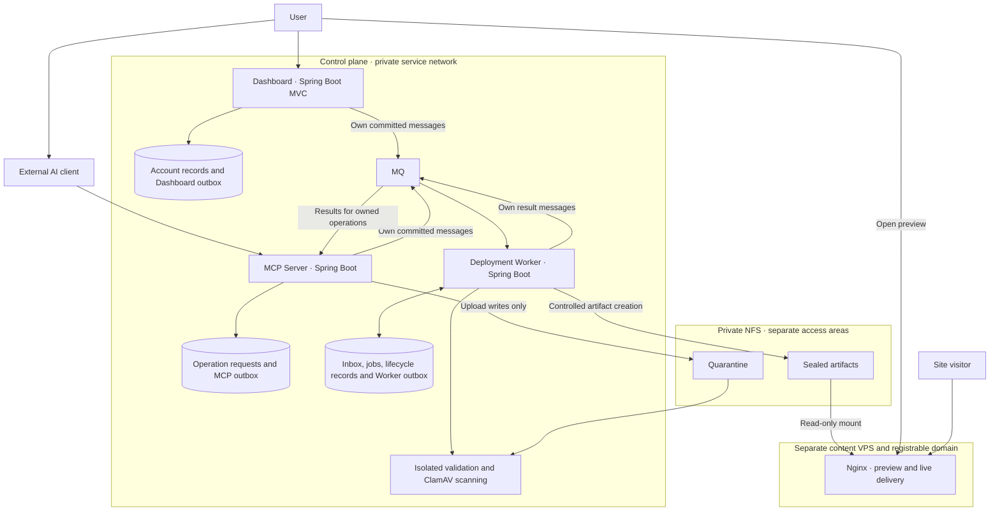
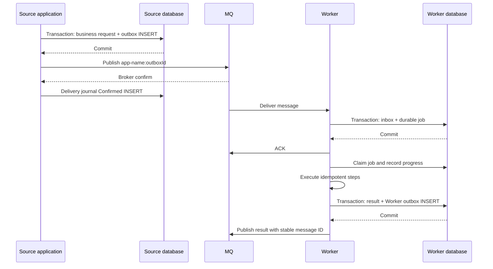
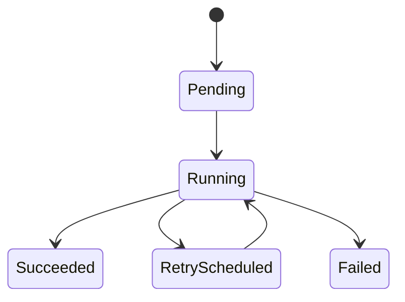
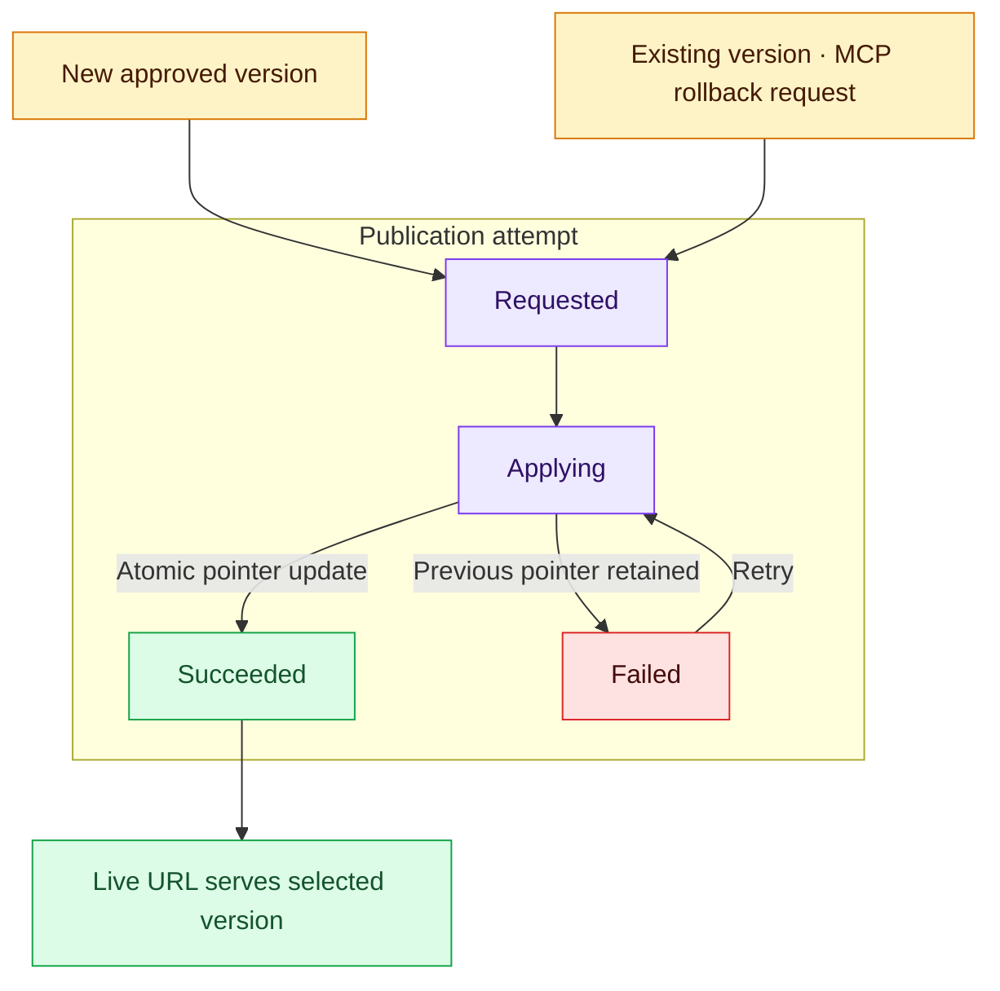
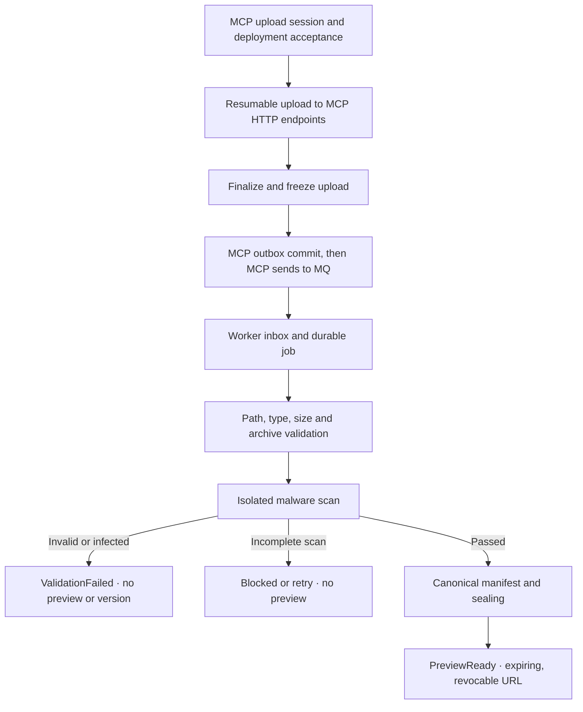
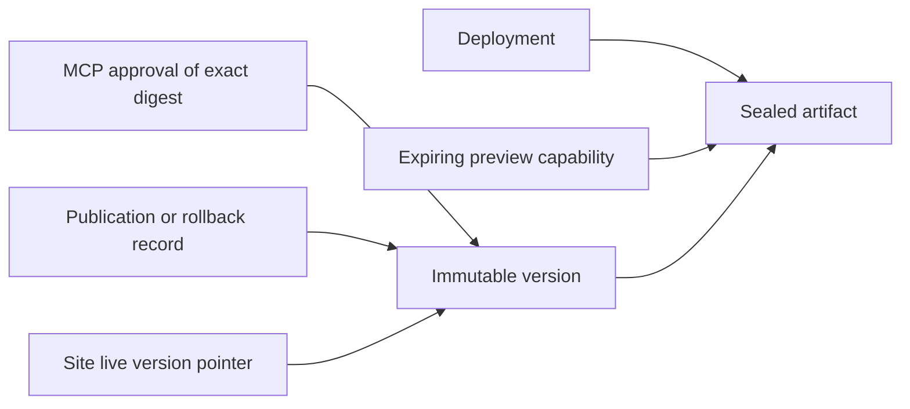

# Architecture

Canonical components, terminology, and lifecycle semantics. See
[Product requirements](PRODUCT_REQUIREMENTS.md) for scope,
[Security](SECURITY.md) for controls, and [Decisions](DECISIONS.md) for rationale.

## System boundaries

Three independently deployable Java / Spring Boot monoliths own separate
responsibilities. Dashboard is Spring MVC for account management; MCP Server is
the sole site-operation entry point; Deployment Worker is a continuously running
background application. It is not launched as a CLI process for each request.



Database boxes express logical ownership, not a decision to deploy separate
PostgreSQL servers. Account events go only to relevant consumers; the deployment
worker does not consume every dashboard event. No separate outbox relay exists.
Delivery route resolution is still an open choice; the NFS arrow is a file-data
path, not authorization to expose every artifact directory publicly.

## Application ownership

| Application | Owns | Does not own |
| --- | --- | --- |
| Dashboard | Registration, sessions, account details, password changes, API key lifecycle and MCP connection instructions | Deployment, preview creation/renewal, approval, publication, rollback or version management |
| MCP Server | Authenticated site commands, large upload sessions, basic deployment acceptance, request idempotency and safe status queries | Executing long-running file processing or changing live files directly |
| Deployment Worker | Inbox/jobs, validation, sealing, preview preparation, version creation, publication, rollback and cleanup | Browser account UI or a public site-management API |

MCP exposes durable operation status through the
[asynchronous command contract](MCP_DESIGN.md#large-uploads-and-asynchronous-commands).

## Application-owned messaging



- Business intent and outbox insertion share a local database transaction. MQ
  sending happens after commit; database rollback sends no message.
- All outbox tables are insert-only, including the worker's result outbox. Do
  not update a row to record sent status, retry count or an error.
- An append-only delivery journal records attempts, errors and broker confirms.
  A broker confirm means broker acceptance, not completed business processing.
- Each application retries its own unconfirmed messages on startup and
  periodically. This recovery runs inside the producer application; there is
  no separate relay process, service or deployment.
- A crash after broker acceptance but before recording confirmation can cause
  redelivery. The delivery model is at-least-once, not exactly-once.
- `messageId = app-name:outboxId`; use a stable logical application name and
  globally unique outbox ID. Retries preserve the ID and payload. Instance,
  container and pod names must not be used as source application identities.
- `sourceApp`, `operationId`, `correlationId`, `causationId`, message type and
  schema version make source and processing history traceable. Actor metadata
  includes account and safe API key ID, never the raw key.
- Request idempotency is separate from message deduplication: identical retried
  intent returns the original operation; the same request key with different
  canonical input returns `conflict` rather than creating another outbox row.
- The worker has a unique inbox message identity. Inbox and durable job creation
  commit before MQ ACK. Duplicate delivery does not create a second job.
- Inbox and current job state may be updated. Completed job attempts retain an
  append-only history of times, step, outcome and safe errors. Outbox immutability
  does not prohibit updating domain state such as the live version pointer.
- Worker replicas share durable PostgreSQL inbox/job state. "Local inbox" means
  worker-owned storage, not an ephemeral container disk or per-replica database.
- Jobs use leases and recovery for interrupted work. Retrying external file
  effects must verify existing artifact identity/digest and avoid duplicate
  versions/publications; inbox deduplication alone cannot guarantee that.
- Worker results commit with its own outbox and are sent by the worker. Result
  consumers, including MCP, must deduplicate events and prevent stale status
  regression. Their exact projection layout remains an implementation decision.
- MQ carries bounded metadata and artifact references, never uploaded file bytes.
  Do not use MQ messages as a substitute for account/site authorization.



Job execution states are distinct from deployment and publication states below.
A malware rejection is a business validation result; an unavailable scanner is
an infrastructure failure that may be retried. A recovered job must not apply a
stale publication over newer live state.

## Domain model

The database schema is not yet selected. Keep these concepts explicit:

| Concept | Meaning and retained metadata |
| --- | --- |
| Account | Registered identity, credentials, Terms acceptance, session/security state, and key lifecycle controls. Registration fields are defined in the PRD. |
| Site | Account-owned website, free subdomain, lifecycle state, current published-version pointer, and history. |
| API key | Account owner, non-recoverable key representation, state, and creation/revocation/rotation timestamps. |
| MCP connection | Logical projection of account, site, endpoint, and active-key metadata; not necessarily a mutable entity or a subdomain-specific configuration. |
| Deployment | Accepted submission record: submitter, idempotency key, source metadata, manifest/digest, validation result, preview reference, lifecycle state, timestamps, and safe errors. Failed validation creates no preview or version. |
| Approval | MCP-originated approval intent, authenticated account and API key identity, deployment, decision, exact manifest digest, and timestamp. Separate human confirmation evidence remains an open security decision. |
| Version | Immutable content created from an approved deployment: source deployment, ID/number, manifest, approved digest, and creation time. |
| Preview | Non-live rendering of a sealed deployment or existing version, accessed under the preview security policy. |
| Publication | Auditable publish or rollback attempt: actor, reason, target and previous versions, result, and timestamps. Success atomically updates the live pointer. |
| Audit event | Actor, action, target, timestamp, result, and safe metadata. |

## Deployment lifecycle


- Only documented state transitions are allowed.
- A transition must be idempotent and reject stale or incompatible state.
- Validation seals the artifact before entering `PreparingPreview`.
- The `PreviewReady` to `Approved` transition records approval and creates the
  immutable version against the same manifest digest.
- `ValidationFailed` is terminal for that deployment; corrected content creates
  a new deployment.
- `PreviewFailed` and failed publication attempts may be retried without
  changing the sealed artifact or creating duplicate records.
- Approval stores the actor, timestamp, deployment ID, and manifest digest.
- Publication verifies the approved digest before changing live state.
- Concurrent publication and rollback operations must use transactional or
  compare-and-swap protection for the site's published pointer.
- A failed publish or rollback leaves the previous pointer unchanged.

## Publication and rollback



Approval and version creation finish before a publication attempt begins.
Rollback records a new publication selecting an existing version; version
contents remain unchanged.

## Upload and validation flow



Upload bytes are streamed into quarantine. Finalization freezes verified input;
all transfer modes converge on one canonical manifest. Transfer contracts belong
in [MCP design](MCP_DESIGN.md#large-uploads-and-asynchronous-commands), and validation
controls in [Security](SECURITY.md#static-file-and-upload-security). Once preview
is ready, follow the [deployment lifecycle](#deployment-lifecycle) and
[publication flow](#publication-and-rollback).

## Storage expectations

Use isolated account/site namespaces and keep artifact bytes separate from
publication pointers, as described below.

### Directory-backed artifacts and versions

Metadata lives in PostgreSQL; file bytes live in ordinary NFS directories.
Immutable artifacts do not require a Git repository or an object-storage product.
The proposed layout is:

```text
/quarantine/{accountId}/{siteId}/{uploadId}/...
/artifacts/{accountId}/{siteId}/{artifactId}/manifest.json
/artifacts/{accountId}/{siteId}/{artifactId}/content/...
```

A manifest contains canonical paths, sizes and file hashes. Its deterministic
hash identifies the approved content; directory names identify storage objects.
Hashes detect changes; access restrictions and storage operations enforce sealing.
A version can permanently reference the same sealed artifact used by its preview,
without copying large files at approval.



Do not make a permanent version depend on an expiring deployment directory.

Prepare and verify files before committing durable version references. Filesystem
operations do not join PostgreSQL transactions. Interrupted preparation may leave
an unreferenced artifact for recovery; it must not leave an approved version
pointing to incomplete files. Cleanup and approval must coordinate so a version
reference cannot race with deletion.

### Retention and archive

Apply the [product retention policy](PRODUCT_REQUIREMENTS.md#retention-and-archive).
The proposed cleanup interpretation is the last 10 completed,
unversioned deployments per site; confirm this scope before implementing cleanup.
Active uploads, validation, approval and publication work must be protected.
Never delete an artifact referenced by a version. Retain deployment metadata when
its temporary files expire and report preview unavailability accurately.
Abandoned uploads and infected quarantine require separate expiry policies.

Version archiving remains under evaluation. The proposed behavior is reversible
list hiding without file deletion or storage savings; a live version would need
to be replaced or unpublished first. Cold storage is not selected. Permanent
retention requires backups and tested restoration, not just absence of deletion.

## Runtime and content delivery

Use Nginx on a separate VPS with a read-only mount of sealed content from private
NFS. Do not mount quarantine on the content VPS. Restrict exports and identities:
MCP writes upload areas, validation sees only its job input, and worker storage
operations create sealed artifacts. PostgreSQL uses its own durable disk, not
NFS. Keep NFS private and restrict server-side write privileges; a read-only
Nginx mount alone does not make files immutable for other clients.

Containerized deployment is intended. Docker Compose is the recommended initial
option for management simplicity, not a final orchestration decision. Kubernetes,
MQ product, database/schema layout and exact Java/Spring versions remain open.
A single application host and NFS server remain failure points; this topology is
not a high-availability guarantee. Availability and recovery objectives remain
[product questions](PRODUCT_REQUIREMENTS.md#open-questions).

Live delivery must resolve only the authorized site's current version; previews
must enforce expiry and revocation. Mounting NFS does not authorize public access
to every artifact or historical version. Two routing alternatives remain open:

| Alternative | Benefit | Trade-off |
| --- | --- | --- |
| Private resolver reads DB and returns an internal Nginx file redirect | One authoritative live pointer and direct Nginx byte delivery | New requests depend on resolver and DB availability; hosting the resolver is undecided |
| Local Nginx route/pointer projection | Can serve during application outages | Requires desired/applied state, recovery, acknowledgment and cache-consistency design |

No resolver is assigned to Dashboard by this decision. Dashboard remains an
account application. A DB update and an NFS symlink/edge route change are not a
single atomic transaction. Select the routing/availability contract before
implementation; preserve publication failure and stale-transition guarantees.
Cache behavior and cross-request asset consistency must be specified with it.

## Remaining implementation decisions

- Human-confirmation evidence for MCP approval, publication and rollback; API key
  authentication alone is not proof of a separate human decision.
- MQ durability, routing, retry/backoff, poison-message policy and ordering;
  result projections and physical DB/schema ownership.
- Container orchestration and exact runtime/library versions.
- Upload protocol, quotas, file types, scan limits and signature freshness.
- Live route resolution, control-plane outage behavior and cache guarantees.
- Preview lifetime/renewal rules, temporary retention scope, archive semantics,
  quarantine expiry, message/audit retention and backup/restore objectives.

These are implementation gates, not silently selected defaults. Current work
records architecture and product decisions; it does not deliver runtime services.
