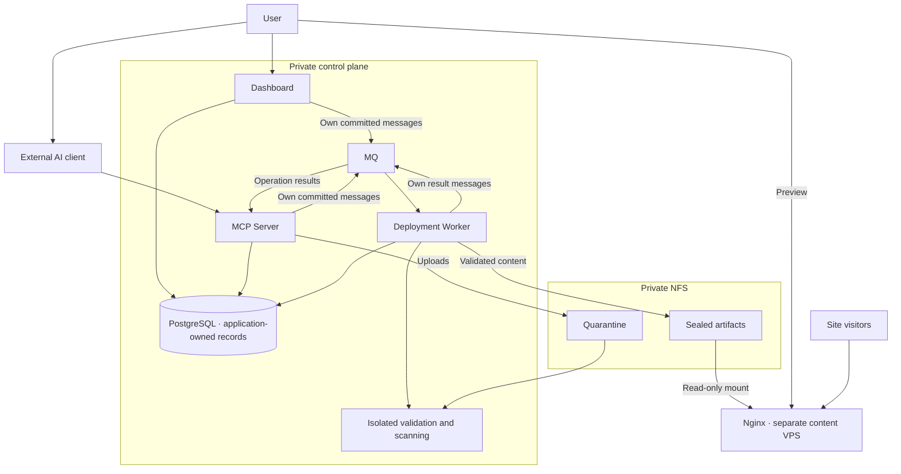
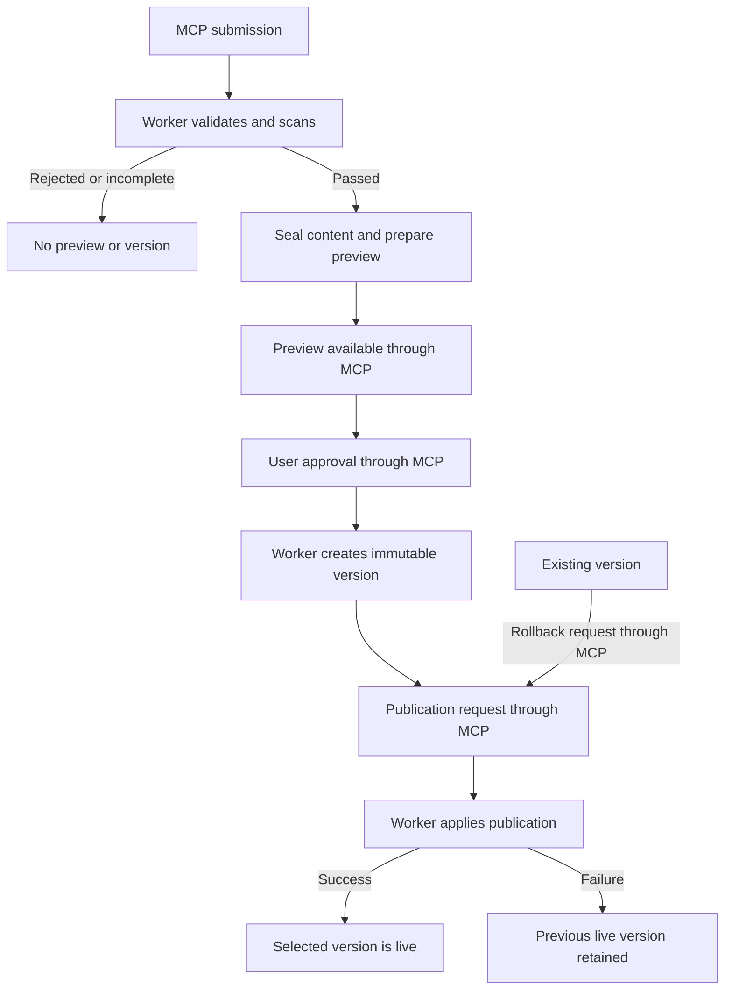
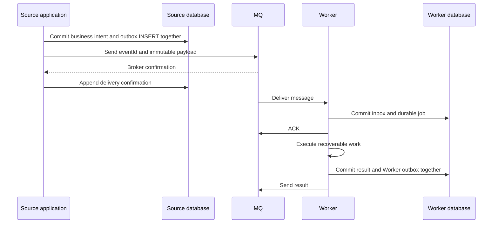

# Architecture

The system framework: application ownership, processing, storage and delivery.
[Product requirements](PRODUCT_REQUIREMENTS.md) defines user-visible behavior;
[Security](SECURITY.md) defines trust boundaries; [Decisions](DECISIONS.md) records
rationale. Detailed implementation designs belong in the relevant OpenSpec change.

## System boundaries

Use three independently deployable Java / Spring Boot monoliths. Dashboard uses
Spring MVC; Deployment Worker runs continuously rather than as a per-request CLI.

The PostgreSQL box is one cluster with a small shared platform schema and
application-owned schemas. Separate least-privilege runtime roles protect each
application's domain tables. All applications may allocate identifiers from the
shared `platform.global_id_seq`; that grant does not authorize cross-schema domain
access. Account events reach relevant consumers; Worker does not consume every
Dashboard event. NFS access does not make all stored artifacts publicly accessible.

## Runtime baseline

V1 uses Java 21, Spring Boot 4.1.1, Spring Framework 7.x, Spring AI 2.0.1 and the
Gradle 9.7.1 wrapper. Spring Boot dependency management owns Spring Framework,
Liquibase and common runtime dependencies. The Spring AI BOM owns the MCP Java
SDK. Do not override BOM-managed transitive versions without a later accepted
compatibility decision.

Liquibase owns ordered migrations for the shared foundation objects and each
application schema. Migration roles apply DDL; normal runtime roles do not hold
DDL privileges. Applied changesets are not rewritten. Migration validation must
cover an empty database and supported upgrades once a prior runtime schema exists.

Database identifiers use PostgreSQL `BIGINT` and Java `long`/`Long`. MCP/JSON
serializes them as decimal strings so JavaScript clients do not lose precision.
Shared sequence values are globally unique but intentionally not gapless,
chronological, secret or authoritative for access control.

## Application ownership

| Application | Responsibility |
| --- | --- |
| Dashboard | Registration, sessions, account/password management, API keys and MCP connection instructions. No site-operation controls. |
| MCP Server | All site commands and status queries, deployment acceptance, large uploads and request idempotency. |
| Deployment Worker | Durable processing, validation, sealing, preview preparation, version creation, publication, rollback and cleanup. |

## Domain model

| Concept | Meaning |
| --- | --- |
| Account / Site | Separate concepts with one site per V1 account. |
| API key / MCP connection | Account access and derived connection information. |
| Deployment | An accepted submission and its processing history, including failures. |
| Artifact | A fixed set of validated files identified by a canonical manifest digest. |
| Preview | Temporary read access to one sealed artifact or existing version. |
| Approval | The user's decision bound to the exact reviewed artifact. |
| Version | A permanent, immutable reference to approved content. |
| Publication | A recorded request to make a version live or restore an older version. |

## Deployment lifecycle

This is the conceptual workflow, not an assertion that a DB write alone updates
Nginx delivery. Deployment, job execution and publication have separate progress.
The accepted state-transition baseline is retained in [ADR-009](docs/decisions/ADR-009.md).
Retries must not duplicate effects or overwrite newer state. Rejected content
requires a new deployment; transient processing failures may be retried safely.

### Upload and validation flow

MCP accepts the deployment before content validation and owns large-file transfer.
Finalized input is frozen in quarantine, validated and scanned in isolation.
Only successfully checked content can be sealed and previewed. V1 uses ClamAV
behind a portable scanner interface, normally as a containerized sidecar/service;
[scanning controls](SECURITY.md#isolated-scanning) still apply. Transfer details
belong in [MCP design](MCP_DESIGN.md#large-uploads-and-asynchronous-commands).

### Publication and rollback

Approval creates a version of the exact sealed content. Publication and rollback
select a version through the site's live pointer; neither rewrites version files.
Rollback creates a publication record without creating another version.

Publication requests, failed attempts and technical retries must remain auditable.
A retried request must not create duplicate publication effects. The detailed
record boundary between a publication, its attempts and precondition rejections
remains to be specified before implementation; the wording in ADR-009 does not
remove the [product audit requirement](PRODUCT_REQUIREMENTS.md#versioning-and-publishing).

## Application-owned messaging

- Each application sends and recovers its own committed messages. There is no
  separate outbox relay. Startup and periodic recovery handle unconfirmed sends.
- All outboxes are insert-only, including Worker results. Attempts, errors and
  confirmations go in a separate append-only journal. Inbox/job and domain state
  may change; normal application roles cannot update or delete outbox rows.
- Delivery can repeat. Preserve the global `eventId` and immutable payload across
  retries. Record `sourceApplication` separately using the stable logical
  application name, not a replica name.
- Worker owns durable, shared inbox/job storage and records it before ACK.
  Recover interrupted jobs and deduplicate effects, including file operations.
- Preserve source, actor, operation and related-message identities with safe
  attempt/error history. `operationId` identifies the business operation;
  `eventId` uniquely identifies one outbox/MQ event; optional
  `causationEventId` links a follow-up event to its cause. An operation may emit
  multiple independently deduplicated events. Result consumers deduplicate by
  `eventId` and reject stale updates.
- Request idempotency is separate from message identity. Store the client key
  under `(accountId, operationType, idempotencyKey)` with a normalized request
  fingerprint and resulting `operationId`. Identical retries return the original
  operation; changed input conflicts. MQ carries bounded metadata and file
  references, never uploaded bytes or raw credentials.

V1 uses standalone Apache ActiveMQ Artemis 2.42.0 as a single broker node with a
disk-backed persistent journal, durable queues/messages and explicit consumer
acknowledgement after durable inbox/job acceptance. Artemis runs separately from
the applications; embedded mode is not used. The outbox and inbox are the durable
application records, while MQ is transport. Broker outage leaves committed
outbox events pending for recovery. V1 does not promise broker high availability.

[ADR-012](docs/decisions/ADR-012.md) retains the application-owned messaging
decision; [ADR-017](docs/decisions/ADR-017.md) selects its runtime, broker,
migration and identity baseline.
Broker confirmation means delivery acceptance, not completed business processing.

## Storage expectations

### Directory-backed artifacts and versions

PostgreSQL stores metadata; ordinary private NFS directories store file bytes.
Directory names locate content; manifest digests identify the exact approved
bytes. Storage permissions enforce immutability. Git or object storage is not
required for versioning.

A preview and a permanent version may reference the same sealed artifact without
copying large files at approval. A version must never depend on temporary files
that cleanup can remove. File preparation and DB updates are separate operations:
recovery and cleanup coordination must prevent incomplete or deleted references.

### Retention and archive

Apply the [product retention policy](PRODUCT_REQUIREMENTS.md#retention-and-archive).
Cleanup protects active work and version references; expired temporary content
does not erase deployment history. Permanent retention also requires backups and
tested restoration. [ADR-013](docs/decisions/ADR-013.md) records storage decisions
and the still-unconfirmed archive proposal.

## Runtime and content delivery

Nginx runs on a separate VPS and mounts only sealed content read-only; it never
mounts quarantine. Applications use configured POSIX filesystem paths and do not
depend on NFS-specific APIs. The operator may provide those paths through NFS
mounts. PostgreSQL uses its own durable storage, not the artifact mount.
Control-plane and content-plane domains and privileges remain isolated under
[Security](SECURITY.md#preview-and-publishing-integrity).

Delivery exposes only the current live version or a valid preview capability.
Live routing is unresolved between DB-backed resolution and an edge projection.
DB and edge changes are not one transaction; the publication design must define
when content is actually live, preserve failure guarantees, and handle stale
updates, caches and outages. The current topology does not promise high availability.

Containerized deployment is intended. Docker Compose is recommended for initial
management simplicity; Kubernetes has not been ruled out or selected.

## Remaining implementation decisions

Resolve these in the OpenSpec change for the affected capability, before its
implementation. They do not block unrelated work or imply selected defaults.

| Before working on | Resolve |
| --- | --- |
| Account and MCP integration | Remaining account policy details, verified Streamable HTTP client list, and credential-revocation propagation target. |
| Messaging and Worker | Production role names/secret source, queue routing, retry/backoff limits, dead-letter policy, ordering policy and recoverable job execution. |
| Upload and cleanup | Transfer protocol, limits, ClamAV signature policy, retention scope and archive behavior. |
| Publication and operations | Live routing, publication/attempt records, availability, cache behavior, backups and audit/message retention. |
| Runtime packaging | Production orchestration beyond the selected initial Compose path and resource sizing. |

Keep current scope and guarantees in these overview documents. Use OpenSpec for
schemas, protocols, detailed failure scenarios, acceptance tests and implementation
tasks; add an ADR when that work changes a significant architecture decision.
