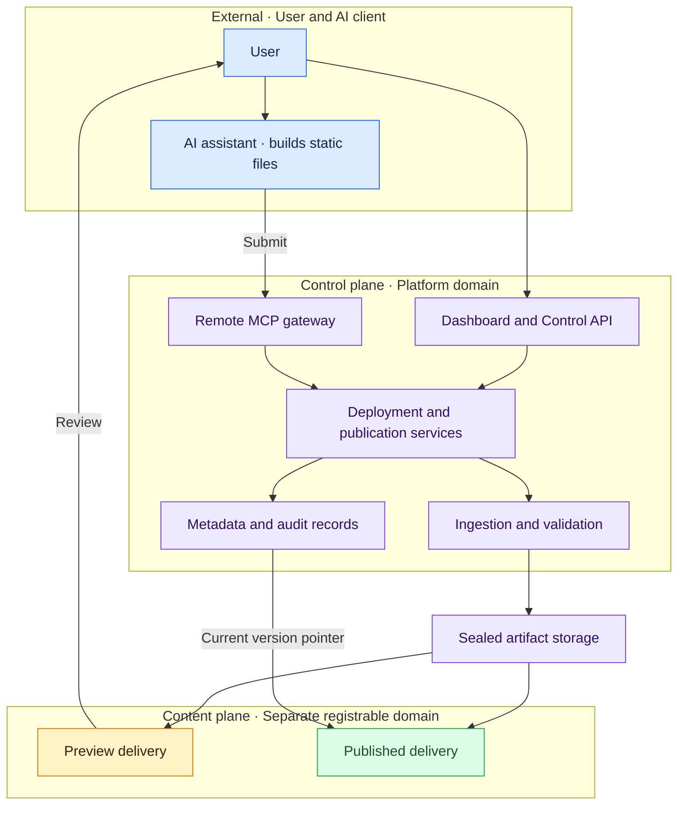
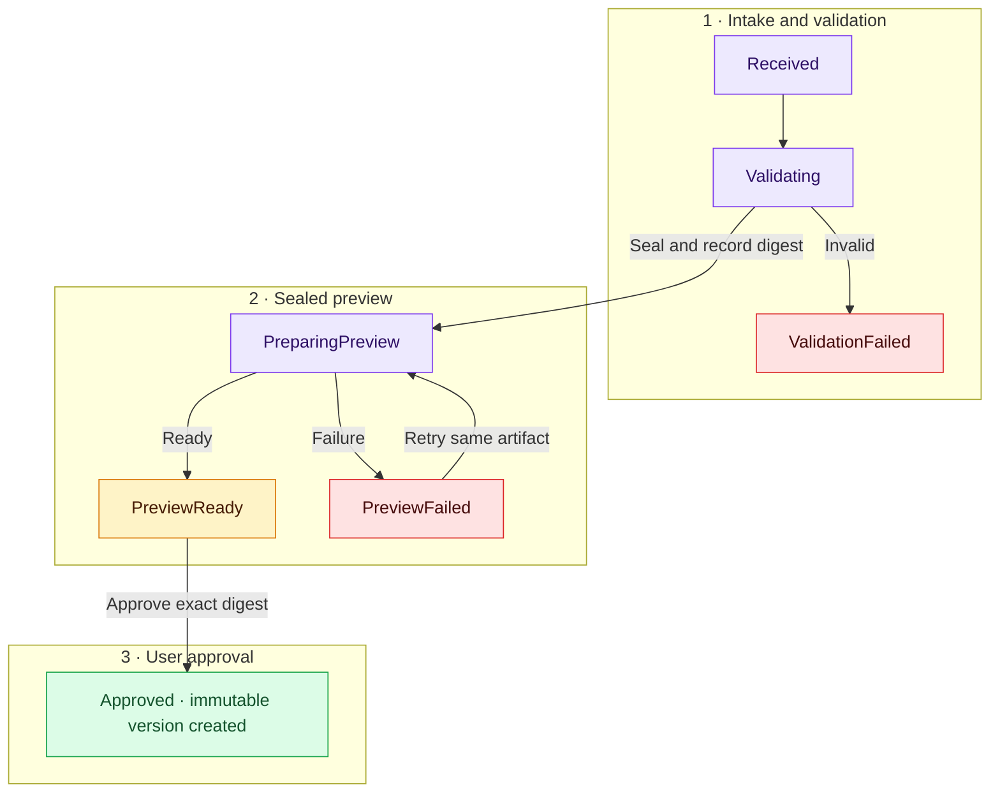
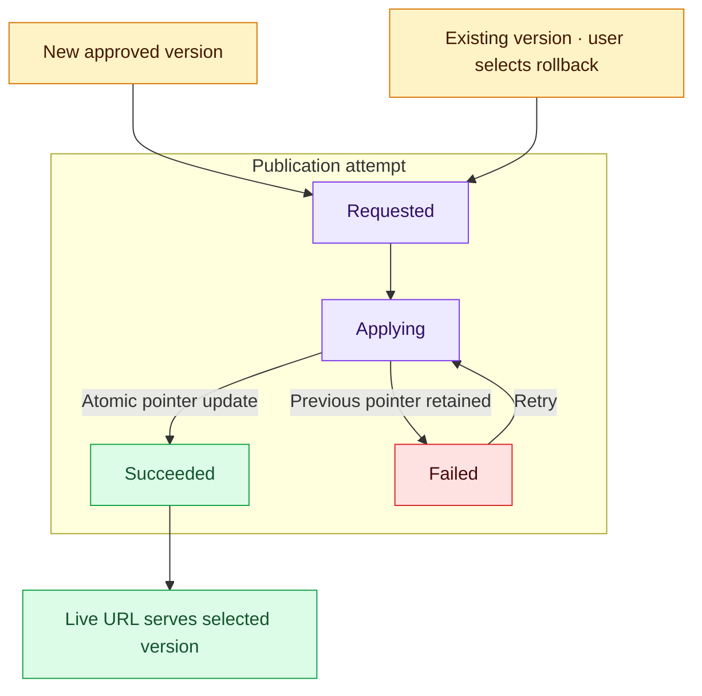

# Architecture

Canonical components, terminology, and lifecycle semantics. See
[Product requirements](PRODUCT_REQUIREMENTS.md) for scope,
[Security](SECURITY.md) for controls, and [Decisions](DECISIONS.md) for rationale.

## System boundaries

The AI runs outside Codomain. Dashboard and MCP coordinate operations;
preview and live delivery serve user content under the
[isolation requirements](SECURITY.md#preview-and-publishing-integrity).

## Logical components

- Dashboard application: handles browser authentication, account management,
  API key lifecycle, approval, publication, and rollback actions.
- Control API: enforces account/site authorization and coordinates domain
  operations for the dashboard.
- MCP gateway: authenticates API keys, validates MCP contracts, applies rate
  limits, and resolves the account and site server-side.
- Deployment service: creates deployment records and enforces lifecycle state
  transitions and idempotency.
- Ingestion and validation worker: normalizes paths, validates limits and file
  rules, builds the manifest, computes its digest, and seals accepted artifacts.
- Artifact storage: stores deployment and version content in account/site
  namespaces and prevents mutation after sealing.
- Metadata store: persists accounts, sites, key metadata, deployments,
  approvals, versions, publication events, and audit events.
- Preview delivery: serves sealed artifacts or immutable versions through
  time-limited capability URLs on an isolated content origin.
- Published delivery: resolves the site's current published-version pointer and
  serves the referenced immutable version on the public content origin.
- Audit pipeline: records security-sensitive and lifecycle events without raw
  secrets or full sensitive payloads.

## Domain model

The database schema is not yet selected. Keep these concepts explicit:

| Concept | Meaning and retained metadata |
| --- | --- |
| Account | Registered identity, credentials, Terms acceptance, session/security state, and key lifecycle controls. Registration fields are defined in the PRD. |
| Site | Account-owned website, free subdomain, lifecycle state, current published-version pointer, and history. |
| API key | Account owner, non-recoverable key representation, state, and creation/revocation/rotation timestamps. |
| MCP connection | Logical projection of account, site, endpoint, and active-key metadata; not necessarily a mutable entity or a subdomain-specific configuration. |
| Deployment | Accepted submission record: submitter, idempotency key, source metadata, manifest/digest, validation result, preview reference, lifecycle state, timestamps, and safe errors. Failed validation creates no preview or version. |
| Approval | Authenticated actor, deployment, decision, exact manifest digest, and timestamp. |
| Version | Immutable content created from an approved deployment: source deployment, ID/number, manifest, approved digest, and creation time. |
| Preview | Non-live rendering of a sealed deployment or existing version, accessed under the preview security policy. |
| Publication | Auditable publish or rollback attempt: actor, reason, target and previous versions, result, and timestamps. Success atomically updates the live pointer. |
| Audit event | Actor, action, target, timestamp, result, and safe metadata. |

## Deployment lifecycle

- Only documented state transitions are allowed.
- A transition must be idempotent and reject stale or incompatible state.
- Validation seals the artifact before entering `PreparingPreview`.
- The `PreviewReady` to `Approved` transition records approval and creates the
  immutable version against the same manifest digest.
- `ValidationFailed` is terminal for that deployment; corrected content creates
  a new deployment.
- `PreviewFailed` and failed publication attempts may be retried without
  changing the sealed artifact or creating duplicate records.
- Repeated submissions with the same account-scoped idempotency key return the
  original deployment rather than creating a duplicate.
- Approval stores the actor, timestamp, deployment ID, and manifest digest.
- Publication verifies the approved digest before changing live state.
- Concurrent publication and rollback operations must use transactional or
  compare-and-swap protection for the site's published pointer.
- A failed publish or rollback leaves the previous pointer unchanged.

## Publication and rollback

Approval and version creation finish before a publication attempt begins.
Rollback records a new publication selecting an existing version; version
contents remain unchanged.

## Storage expectations

- Store each account and site in an isolated namespace.
- Store deployment files separately from published pointers.
- Seal accepted deployment artifacts before preview and identify them with a
  deterministic manifest digest.
- Publish by moving or updating a pointer to an immutable version, not by
  rewriting version contents.
- Generated integration content follows [MCP design](MCP_DESIGN.md#connection-details);
  credential storage follows [Security](SECURITY.md#api-keys-and-mcp-authorization).
