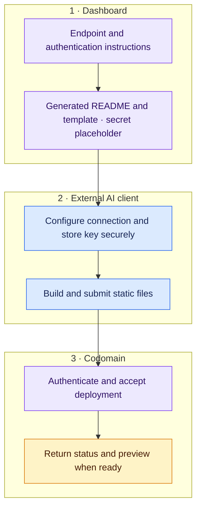

# MCP Design

Canonical AI integration contracts. Concrete schemas and transport remain to
be finalized; the proposed tools below define V1 capability boundaries.

## Connection and authorization

The connection targets the authenticated account's site, not a separate config
per subdomain. Apply [API key authorization](SECURITY.md#api-keys-and-mcp-authorization)
and resolve resource ownership server-side.

## Connection details

The dashboard should provide:

- MCP server URL.
- Required authentication method.
- Active API key metadata and creation or rotation instructions. The raw key is
  displayed only once when issued.
- Copyable MCP client configuration.
- Downloadable generated `CODOMAIN_MCP_README.md` with product context, usage
  instructions, and a secret placeholder.
- Guidance for rotating or revoking keys.

When API key state changes, generated README content and the MCP connection
template must update automatically without embedding the raw secret. The user
must place the newly issued key in the AI client's secret configuration.

## Tool principles

- Tools should be small, explicit, and scoped to the authenticated account's
  single V1 site.
- Tool names should describe publishing-domain behavior rather than AI-client
  behavior.
- Tool responses should be structured, stable, and safe to display in an AI
  client.
- Tools must never return API keys, secrets, private platform URLs, or other
  sensitive internals.
- Tools that create or mutate state must define and enforce idempotency
  behavior.
- Tools must return clear errors without leaking cross-account information.

## Proposed V1 tools

Exact schemas remain implementation decisions. All resources are restricted to
the authenticated account; responses follow the safety rules above.

| Tool | Request / purpose | Expected response |
| --- | --- | --- |
| `get_site_context` | Read the account's site context. | Safe site name/ID, subdomain, live URL, latest preview if available, current version, deployment/version status, static-file constraints. |
| `submit_static_site` | Manifest, static files, account-scoped idempotency key; optional message and client metadata. | Deployment ID, validation and preview status, preview URL when ready, safe warnings/errors. |
| `get_deployment_status` | Inspect an owned deployment. | Deployment ID, validation/preview/approval status, version ID if created, preview URL when available, safe warnings/errors. |
| `list_versions` | List the site's versions. | IDs, labels/numbers, creation timestamps, current-pointer indicator, source deployments, rollback eligibility. |
| `preview_version` | Request a preview of an owned immutable version. | Version ID, preview URL and status. Does not publish. |
| `get_publish_status` | Read current publication state. | Live URL, current version, last publication timestamp, publication record, target version, safe status. |

Submission creates a deployment after authentication and basic acceptance,
before content validation. Follow [upload security](SECURITY.md#static-file-and-upload-security)
before sealing or preview.

Small text files may use inline content; larger or binary assets may use a
controlled two-phase upload. Finalize transfer schemas, limits, and integrity
checks before implementation. Every transfer mode must produce the same
canonical manifest and digest.

## Approval and rollback boundary

MCP prepares previews and reports status. Publication approval and rollback
require authenticated dashboard actions in V1. Follow the
[deployment lifecycle](ARCHITECTURE.md#deployment-lifecycle) and
[approval integrity controls](SECURITY.md#preview-and-publishing-integrity).
File acceptance follows [upload security](SECURITY.md#static-file-and-upload-security).

## Error behavior

MCP errors should be safe, structured, and useful:

- `unauthorized`: the API key is missing, invalid, revoked, or rotated.
- `forbidden`: the authenticated account is known to have the target but lacks
  permission for the requested action.
- `validation_failed`: submitted files or metadata failed validation.
- `not_found`: the requested deployment or version is not available to this
  account.
- `conflict`: the requested operation conflicts with current deployment,
  approval, publish, or rollback state.
- `rate_limited`: the account or key exceeded allowed request volume.
- `internal_error`: the platform failed without exposing implementation
  details.

Error responses must not leak account existence, site existence, private
identifiers, secrets, or cross-account metadata.

Requests for resources outside the authenticated account must return the same
externally observable result as an unavailable resource. They must not use the
`forbidden`/`not_found` distinction to reveal cross-account existence.

## Audit expectations

Record safe audit events for:

- MCP authentication success and failure.
- API key use, revocation, and rotation.
- Deployment submission.
- Validation success and failure.
- Preview creation.
- Version creation.
- Publication approval.
- Publication.
- Version preview.
- Rollback.

Audit records must not contain plaintext API keys, passwords, secrets, or full
sensitive payloads.

## Lifecycle and concurrency

- Deployment status follows the states defined in `ARCHITECTURE.md`.
- State-changing requests must reject stale transitions with a safe `conflict`
  response.
- Reusing a submission idempotency key with identical input returns the
  original deployment; reusing it with different input returns `conflict`.
- Publication integrity and concurrency follow
  [Architecture](ARCHITECTURE.md#deployment-lifecycle).

Future scope is tracked in [Product requirements](PRODUCT_REQUIREMENTS.md#out-of-scope-for-v1).
Permanent public preview URLs are outside V1.
