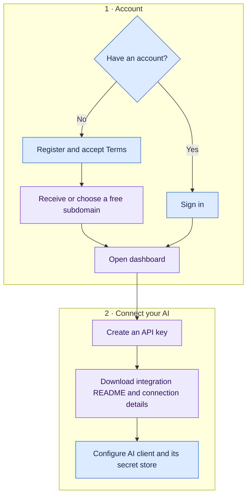

# Product Requirements

Canonical V1 scope and acceptance criteria. [README](README.md) introduces the
product; [Architecture](ARCHITECTURE.md) defines lifecycle semantics.

## Scope

One account owns one static site, one free subdomain, and one account-scoped
MCP connection. V1 serves individuals who bring their own AI client.

## Out of scope for V1

V1 does not include:

- AI model hosting or AI assistant features.
- Visual drag-and-drop site building.
- General-purpose deployment workflows.
- Dynamic application hosting.
- Multiple sites per account.
- Multiple subdomains per account.
- Custom domains.
- Project-specific MCP connections.
- Team members.
- Client-level access.
- Agency workflows.
- Multi-step approval workflows.
- White-label publishing.
- Direct AI-agent publication without explicit user approval.
- Account self-deletion.
- Dynamic server-side execution, databases, background workers, and serverless
  functions.

## Getting started

Adapted from the supplied Excalidraw concept. Subdomain selection and account
verification remain open decisions. See [README](README.md#how-it-works) for
the subsequent publishing journey.

## Requirements and acceptance

### Account and registration

- The system must allow registration with email, first name, last name, and
  password.
- The system must require Terms and Conditions acceptance before account
  creation completes.
- The system must store the accepted Terms version and timestamp.
- The system must allow authenticated users to change their password.
- The system must allow registered users to authenticate, end their session,
  and access the dashboard through a protected browser session.
- The system must define session expiration and revocation behavior.

### Site and subdomain

- The system must create one site for each V1 account.
- The system must assign or allow selection of one free subdomain for the
  account.
- The system must show the free subdomain in the dashboard.
- The system must prevent one account from accessing another account's site,
  subdomain, files, deployments, versions, or previews.

### Dashboard

- The dashboard must show site information, free subdomain, preview URL,
  published URL, deployment history, version history, and rollback controls.
- The dashboard must show MCP connection details.
- The dashboard must provide a downloadable generated
  `CODOMAIN_MCP_README.md` with safe MCP usage instructions and secret
  placeholders.
- The dashboard must allow API key creation, revocation, and rotation.
- The dashboard must update README and MCP connection details when the API key
  changes.
- The dashboard must show a raw API key only at creation or rotation time and
  must show only safe key metadata afterward.
- V1 must allow no more than one active MCP API key per account.

### MCP submission

- The MCP connection must be scoped to the authenticated account and its single
  V1 site.
- The MCP server must allow an authenticated AI client to submit static HTML,
  CSS, JavaScript, and asset files.
- The system must validate submitted file paths, sizes, file counts, and
  content boundaries before artifact acceptance, sealing, or preview.
- The system must create a deployment record after an authenticated submission
  passes basic request acceptance and before content validation begins.
- A deployment must record validation failures without creating a preview or
  version.
- The system must return safe deployment and preview status through MCP.
- Retried submissions with the same idempotency key must not create duplicate
  deployments.

### Preview and approval

- The system must generate a preview URL before publication.
- The preview must represent a specific deployment or version.
- A deployment artifact must be sealed before preview and identified by a
  deterministic manifest digest.
- Preview URLs must be time-limited, revocable capability URLs served from an
  origin isolated from the dashboard.
- The system must require explicit authenticated user approval before
  publication.
- Approval must be bound to the exact sealed artifact digest being approved.
- A newer or different deployment must require a separate approval.

### Versioning and publishing

- Approval of a sealed deployment must create an immutable version that retains
  the approved manifest digest.
- Published state must point to an immutable version.
- Every publish attempt must create an auditable publication record separate
  from the version.
- The system must keep deployment and version history.
- The system must show the current published version.
- Failed publication must not replace the previously published version.

### Rollback

- The system must allow the user to preview a previous version.
- The system must allow rollback to a previous immutable version.
- Rollback must update the published version pointer without rewriting the
  selected version's contents.
- Rollback must create a publication record and must not create a new version.

## Quality requirements

Acceptance also requires [Security](SECURITY.md) and
[Coding standards](CODING_STANDARDS.md), including safe upload rejection,
revoked-key rejection, account isolation, and safe audit records.
Preview, publication, or rollback failure must preserve the previous live site.

## Success metrics

Suggested V1 product metrics:

- Successful account creation rate.
- MCP connection setup completion rate.
- Successful deployment submission rate.
- Preview generation success rate.
- Preview-to-publication approval rate.
- Publication success rate.
- Rollback success rate.
- API key rotation and revocation success rate.

Operational and security telemetry should separately track:

- Cross-account authorization attempts and denials.
- Failed deployment validation reasons.
- Preview capability expiration and revocation failures.
- Publication and rollback state-transition failures.

## Open questions

- What is the final product domain and free subdomain pattern?
- Should free subdomains be user-selected, generated, or both?
- What file size, file count, and total deployment limits should V1 enforce?
- What static file types should be accepted by default?
- What is the permanent private security contact?
- What retention period should deployment files, versions, previews, and audit
  records use?
- Which exact MCP transport and client configuration formats will V1 support?
- Will V1 require email verification and password-reset flows before launch?
- What expiration duration and regeneration rules will preview capability URLs
  use?
- What maximum propagation delay is acceptable for API key revocation and
  rotation?
- What additional consent, if any, does the sketch's “Other Conditions” mean?
