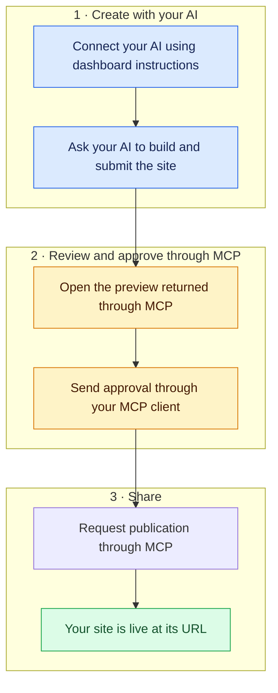

# Codomain

> Your AI assistant builds the website. Our publishing platform puts it live.

Codomain helps you publish a static website built by your own AI assistant.
Bring your HTML, CSS, JavaScript, and assets, review a preview, and approve
the site when it is ready. No hosting or deployment knowledge is required.

## How it works

Your AI connects through MCP, the integration used to send files to Codomain.
Deployment, preview, approval, publication and rollback all run through MCP.
The dashboard is for registration, account/password management, API keys and
connection instructions. Approval remains tied to the exact previewed content.

## What you get in V1

- One site and one free subdomain per account.
- A dashboard with AI connection instructions and API key management.
- Preview and live URLs, deployment history, and saved versions through MCP.
- Previous-version previews and rollback through MCP to restore your site.

Codomain serves static websites. You bring the AI assistant; visual editing,
server-side application hosting, multiple sites, teams, and custom domains
are outside V1.

## Project status

Documentation baseline; runtime implementation has not started. See
[Architecture](ARCHITECTURE.md#system-boundaries) for the selected design and
[remaining implementation decisions](ARCHITECTURE.md#remaining-implementation-decisions)
for choices that must be resolved before building the runtime.

## Documentation

Read Product requirements and Architecture for the system framework. Use MCP
Design and Security for the relevant boundaries, and ADRs for decision history.
Detailed contracts, schemas, failure scenarios and implementation tasks will be
specified in OpenSpec as each capability is developed.

| Read about | Document |
| --- | --- |
| V1 scope and acceptance | [Product requirements](PRODUCT_REQUIREMENTS.md) |
| Components, terminology, lifecycle | [Architecture](ARCHITECTURE.md) |
| AI integration capabilities | [MCP design](MCP_DESIGN.md) |
| Security and reporting | [Security](SECURITY.md) |
| Decision history | [Decisions](DECISIONS.md) |
| Development rules | [Coding standards](CODING_STANDARDS.md) |
| Contribution workflow | [Contributing](CONTRIBUTING.md) |
| Agent instructions | [AGENTS](AGENTS.md) |
