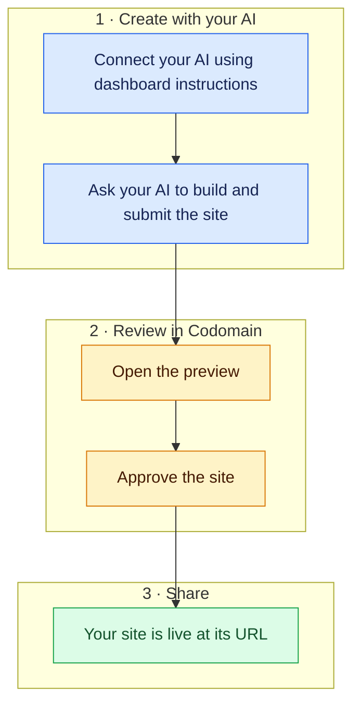

# Codomain

> Your AI assistant builds the website. Our publishing platform puts it live.

Codomain helps you publish a static website built by your own AI assistant.
Bring your HTML, CSS, JavaScript, and assets, review a preview, and approve
the site when it is ready. No hosting or deployment knowledge is required.

## How it works

Your AI connects through MCP, the integration used to send files to Codomain.
Asking it to publish prepares a preview; you approve publication in Codomain.

## What you get in V1

- One site and one free subdomain per account.
- A dashboard with AI connection instructions and API key management.
- Preview and live URLs, deployment history, and saved versions.
- Previous-version previews and rollback to restore your site.

Codomain serves static websites. You bring the AI assistant; visual editing,
server-side application hosting, multiple sites, teams, and custom domains
are outside V1.

## Project status

Product definition and architecture baseline. Application setup and deployment
instructions will follow once the implementation stack is selected.

## Documentation

| Read about | Document |
| --- | --- |
| V1 scope and acceptance | [Product requirements](PRODUCT_REQUIREMENTS.md) |
| Components, terminology, lifecycle | [Architecture](ARCHITECTURE.md) |
| AI integration contracts | [MCP design](MCP_DESIGN.md) |
| Security and reporting | [Security](SECURITY.md) |
| Decision history | [Decisions](DECISIONS.md) |
| Development rules | [Coding standards](CODING_STANDARDS.md) |
| Contribution workflow | [Contributing](CONTRIBUTING.md) |
| Agent instructions | [AGENTS](AGENTS.md) |
