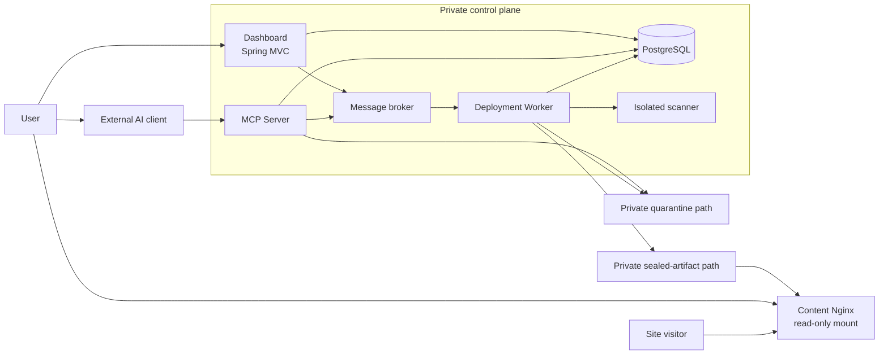
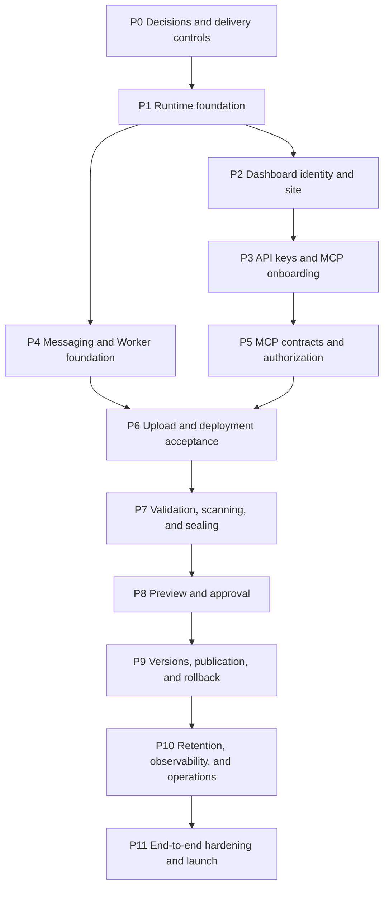

# Codomain V1 Delivery Plan

## 1. Purpose

This document is the implementation roadmap for Codomain V1. It turns the
product, architecture, MCP, and security baselines into ordered delivery work
covering the Dashboard, MCP Server, Deployment Worker, data and messaging,
artifact storage, content delivery, operations, and launch readiness.

This plan does not replace the authoritative documents:

- [Product Requirements](../PRODUCT_REQUIREMENTS.md) owns product scope and
  acceptance criteria.
- [Architecture](../ARCHITECTURE.md) owns component boundaries, lifecycle,
  storage, messaging, and deployment topology.
- [MCP Design](../MCP_DESIGN.md) owns the external AI-client integration
  boundary.
- [Security](../SECURITY.md) owns trust boundaries and required controls.
- [Decisions](../DECISIONS.md) owns architectural decision history.
- [Coding Standards](../CODING_STANDARDS.md) and
  [Contributing](../CONTRIBUTING.md) own engineering and delivery rules.

Where those documents leave a choice open, this plan creates a decision gate.
An implementation change must not silently select an unresolved product,
security, or architecture policy.

## 2. V1 Outcome

V1 is complete when an individual user can:

1. Register, accept the Terms, sign in, manage their password, and sign out.
2. Receive or choose one free subdomain for their single account-owned site.
3. Create, rotate, and revoke one active API key from the Dashboard.
4. Configure a supported external AI client using Dashboard instructions.
5. Submit a static website through MCP and observe asynchronous processing.
6. Receive a fixed, isolated, expiring preview of validated and scanned content.
7. Explicitly approve the exact artifact they reviewed.
8. Create an immutable version, publish it, and inspect the live result.
9. Roll back through MCP to a previous immutable version.
10. Recover safely from retries and service interruptions without duplicate
    deployments, versions, or publication effects.

The Dashboard remains limited to account and access management. Site content,
deployment history, preview, approval, publication, and rollback operations are
available through MCP only.

## 3. Explicit V1 Non-Goals

The following work is excluded unless the product requirements are changed
through an approved proposal:

- Hosted AI generation or an AI assistant supplied by Codomain.
- A visual site editor or Dashboard site-operation controls.
- Dynamic applications, customer server-side code, databases, workers, or
  serverless functions.
- Multiple sites or subdomains per account.
- Custom domains.
- Teams, agencies, client access, or role-based collaboration.
- Project-scoped MCP connections.
- Multi-step approvals or autonomous publication without user approval.
- White-label publishing.
- Account self-deletion.
- Kubernetes as a required V1 runtime.
- Automatic deletion of approved immutable versions.

## 4. Delivery Principles

- Deliver vertical, testable capabilities in dependency order.
- Keep domain and application rules independent of Spring, MCP transport,
  persistence, messaging, and mounted-filesystem implementations.
- Use server-side account and site resolution for every protected operation.
- Treat uploaded content as untrusted until validation and isolated scanning
  succeed.
- Bind previews, approvals, versions, publications, and rollbacks to immutable
  artifact identity.
- Separate request acceptance from asynchronous completion.
- Make retries idempotent and retain attributable, secret-free audit history.
- Preserve the previous live site whenever preview, approval, publication, or
  rollback processing fails.
- Keep control-plane and content-plane origins, credentials, and privileges
  isolated.
- Implement each major phase through an approved OpenSpec change with focused
  tests, full-suite validation, and the relevant build.

## 5. Target Delivery Topology

## 6. Workstream and Dependency Map

Phases may overlap only when their dependencies and decision gates are complete.
Every phase below should normally become one or more issue-scoped OpenSpec
changes, branches, and human-reviewed pull requests.

## 7. Decision Gates

### DG-01 Product Identity and Account Policy

The following V1 choices are selected:

- Email verification is required.
- Password reset is required before launch.
- Users may request a subdomain or choose a generated suggestion.
- Both requested and generated names receive an early availability check and an
  authoritative race-safe check during allocation.

Resolve the remaining details before Dashboard registration is implemented:

- Final product domain and free-subdomain pattern.
- Reserved-name list, normalization, release, suspension, and future reuse rules.
- Which operations remain blocked until email verification completes.
- Exact Terms versioning and any additional consent requirements.
- Browser-session idle lifetime, absolute lifetime, and revocation behavior.

Record accepted product policy in the product requirements and significant
security or architecture consequences in an ADR.

### DG-02 Runtime and Persistence Baseline

V1 uses Java 21, Spring Boot 4.1.1, Spring Framework 7.x, Spring AI 2.0.1,
Gradle 9.7.1 and Liquibase as recorded in
[ADR-017](decisions/ADR-017.md). Spring Boot and Spring AI BOMs own their
respective managed dependency versions. One PostgreSQL cluster contains a shared
foundation schema, application-owned schemas and `platform.global_id_seq` for
globally unique `BIGINT` operation/event IDs. Resolve the remaining deployment
details before production deployment:

- Exact production database role names and secret provider.
- Development and production configuration strategy.
- Docker Compose service topology for local and initial production operations.

### DG-03 MCP Client and Transport Contract

V1 uses Spring AI MCP Server WebMVC with Streamable HTTP as recorded in
[ADR-014](decisions/ADR-014.md). Legacy HTTP/SSE and STDIO are not V1 transports.
Resolve before generated client instructions are finalized:

- Supported V1 MCP clients.
- Exact supported MCP protocol/Spring AI versions.
- Endpoint path and authentication-header convention.
- Client configuration examples and secret-store expectations.
- Compatibility and version-negotiation policy.

### DG-04 Human Approval Proof

V1 uses the agent-mediated explicit confirmation selected in
[ADR-015](decisions/ADR-015.md). Dashboard confirmation is not required. The
implementation change must specify challenge lifetime, client presentation,
action-specific challenge issuance, one-time use, actor identity, replay
protection, revocation behavior, and the exact approval/publication/rollback
schemas. An API key or bare client-supplied boolean alone is not sufficient.

### DG-05 Upload and Static-Content Policy

Resolve before upload acceptance is exposed:

- Inline submission limit, individual file-size limit, file-count limit, total
  deployment limit, and archive-expansion limit.
- Allowed and blocked file types, executable-content policy, MIME detection,
  and delivery headers.
- Resumable-transfer protocol, chunk sizing, integrity checks, expiry, and
  client support.
- Quarantine expiry and the exact scope of the last-10 temporary-content rule.
- Whether archive upload is supported in V1.

### DG-06 Messaging and Job Execution

V1 uses standalone single-node ActiveMQ Artemis 2.42.0 with a disk-backed
persistent journal, durable queues/messages and explicit acknowledgement after
durable inbox/job acceptance. Every cross-application event is committed to an
insert-only outbox with business intent before MQ delivery. V1 does not promise
broker HA. Resolve before asynchronous processing is implemented:

- Stable application identities, queues/topics, routing, and dead-letter policy.
- Message envelope schema and compatibility rules.
- Retry limits, backoff, ordering, stale-result rejection, and poison-message
  handling.
- Authorization freshness for delayed sensitive operations.

### DG-07 Scanner and Isolation

V1 uses ClamAV behind a portable scanner interface, normally as a private
containerized service, as recorded in [ADR-016](decisions/ADR-016.md). Resolve
before preview readiness can be achieved:

- Signature-update and signature-freshness policy.
- Isolation mechanism and CPU, memory, disk, network, and time limits.
- Unavailable, stale-signature, timeout, and infrastructure-failure behavior.
- Rescan, incident containment, and evidence-retention policy.

### DG-08 Preview, Routing, and Publication

Resolve before content delivery integration:

- Preview capability lifetime, renewal, revocation, and unavailable-content
  behavior.
- Live routing strategy: database-backed resolution or edge projection.
- Publication and publication-attempt record boundary.
- Atomicity/recovery strategy between database state and content routing.
- Cache behavior, propagation target, stale update protection, and outage
  behavior.
- Live-site availability and recovery objectives.

### DG-09 Retention, Backup, and Audit

Resolve before production readiness:

- Audit, message journal, upload-session, quarantine, and operational-log
  retention periods.
- Archive behavior, if any, exposed through MCP.
- Backup scope, encryption, schedule, recovery point objective, and recovery
  time objective.
- Suspension, takedown, evidence preservation, and restoration procedures.

## 8. Detailed Implementation Plan

## Phase P0 - Planning, Decisions, and Delivery Controls

**Goal:** Establish approved boundaries and convert this roadmap into manageable
implementation changes.

### P0-T01 Reconcile repository state

- Inventory tracked and untracked modules, build files, prototypes, and local
  generated state.
- Compare existing runtime code with the authoritative V1 architecture.
- Identify code that can be retained, code that requires redesign, and code that
  should be removed only through an explicitly approved change.
- Update the README statement about implementation status when the repository
  has an agreed runtime baseline.
- Ensure caches, IDE files, local secrets, and generated outputs are excluded
  appropriately without removing user work.

**Acceptance:** The team has a reviewed inventory and no prototype is treated as
production-ready without verification.

### P0-T02 Create the implementation change map

- Create separate OpenSpec changes for the phases or coherent vertical slices.
- Recommended initial change sequence:
  `implement-runtime-foundation`, `implement-dashboard-account-access`,
  `implement-mcp-auth-and-onboarding`, `implement-deployment-submission`,
  `implement-worker-artifact-processing`, `implement-preview-and-approval`,
  `implement-publication-and-rollback`, and
  `implement-production-operations`.
- Give each change explicit scope, non-goals, design, delta specifications,
  detailed tasks, acceptance scenarios, and validation commands.
- Link each change to its GitHub issue before implementation.

**Acceptance:** Every implementation task belongs to one approved change and one
issue-scoped delivery branch.

### P0-T03 Close decisions needed by the first delivery slice

- Complete DG-01 and DG-02.
- Create or update ADRs for significant selected architecture decisions.
- Update only the authoritative documents that own changed requirements.
- Validate OpenSpec artifacts and documentation links.

**Acceptance:** Runtime and registration work has no unresolved decision that
would change its schema, public behavior, or security model.

## Phase P1 - Runtime Foundation

**Goal:** Produce a reproducible, secure, testable foundation for the three
independently deployable Spring Boot applications.

### P1-T01 Establish the Gradle multi-project build

- Pin Java 21, Gradle 9.7.1, Spring Boot 4.1.1 and Spring AI 2.0.1; let the
  Spring Boot and Spring AI BOMs own their managed transitive versions.
- Include only intended modules: shared domain/application code where justified,
  Dashboard, MCP Server, Deployment Worker, and test-support modules if needed.
- Prevent framework dependencies from leaking into domain modules.
- Configure compiler warnings, test platform, formatting/static analysis, and
  dependency locking or another approved reproducibility mechanism.
- Add aggregate test and build commands suitable for local use and CI.

**Acceptance:** A clean checkout can run the full build and all empty/smoke tests
using documented commands.

### P1-T02 Define configuration and secret handling

- Create typed configuration for database, broker, NFS roots, public origins,
  cookie policy, key hashing, preview policy, and scanner integration.
- Provide safe local defaults only where they cannot weaken production.
- Use environment or managed-secret references for credentials.
- Fail startup with actionable errors for missing production configuration.
- Ensure configuration dumps and health endpoints cannot expose secrets.

**Acceptance:** Each service starts with a documented local profile and rejects
unsafe or incomplete production configuration.

### P1-T03 Establish PostgreSQL and migrations

- Use Liquibase with a shared foundation changelog and application-owned ordered
  changesets; do not rewrite applied changesets.
- Create service database roles with least privilege.
- Create `platform.global_id_seq` and grant application roles sequence use
  without cross-schema domain-table access.
- Use PostgreSQL `BIGINT`, Java `long`/`Long`, and decimal-string MCP/JSON IDs;
  treat sequence gaps as normal and IDs as opaque.
- Define timestamp, optimistic-concurrency, and audit-column conventions.
- Add initial schemas for accounts, sites, credentials, messaging, deployments,
  artifacts, previews, approvals, versions, publications, and jobs only as their
  owning changes are delivered.
- Add migration tests against the supported PostgreSQL version.

**Acceptance:** Migrations apply from empty state, upgrade from the prior schema,
and run under intended service roles.

### P1-T04 Create local infrastructure

- Add Docker Compose services for PostgreSQL, standalone Artemis 2.42.0 with a
  persistent journal volume, private file storage mounts, scanner dependencies,
  and content Nginx as decisions permit.
- Separate quarantine and sealed-artifact paths, mounts, and permissions.
- Give content Nginx read-only access only to sealed content.
- Add health checks, dependency ordering, named volumes, and sample environment
  configuration without credentials.
- Document startup, shutdown, reset, and troubleshooting behavior.

**Acceptance:** A developer can reproduce the local topology and verify that the
content server cannot read quarantine or write sealed artifacts.

### P1-T05 Establish CI quality gates

- Run formatting/static analysis, focused tests, full tests, migration tests,
  dependency checks, and application builds.
- Scan committed secrets, dependencies, container images, and configuration.
- Publish test evidence while excluding secrets and uploaded content.
- Fail on missing required checks or incompatible migrations.

**Acceptance:** Pull requests receive deterministic pass/fail evidence for all
required validation.

## Phase P2 - Dashboard Identity, Account, and Site

**Goal:** Deliver registration and secure account access while preserving the
Dashboard's limited responsibility.

### P2-T01 Model account, Terms acceptance, and site ownership

- Define Account, Site, SubdomainAllocation, TermsAcceptance, and Session domain
  concepts and invariants.
- Enforce one site and one free subdomain per V1 account at database and
  application boundaries.
- Store normalized email separately from display input as required.
- Record Terms version and acceptance timestamp transactionally with account
  creation.
- Define account states required for verification, suspension, and access.

**Acceptance:** Concurrent registration and site creation cannot violate V1
cardinality or subdomain uniqueness.

### P2-T02 Implement registration

- Build accessible registration UI for email, first name, last name, password,
  password confirmation, and Terms acceptance.
- Validate inputs consistently on client and server; server validation remains
  authoritative.
- Hash passwords using the selected adaptive algorithm and approved parameters.
- Allocate a subdomain according to DG-01 without revealing account existence.
- Rate-limit attempts and emit safe audit events.
- Implement the required email-verification flow.

**Acceptance:** Valid registration atomically creates the account, Terms record,
site, and subdomain; invalid or conflicting requests reveal no private account
information and leave no partial account.

### P2-T03 Implement sign-in and session lifecycle

- Authenticate using constant-behavior responses for unknown email and invalid
  password where practical.
- Issue Secure, HttpOnly, host-only, appropriately scoped cookies using the
  `__Host-` prefix where supported.
- Apply CSRF protection, session fixation prevention, idle and absolute expiry,
  logout invalidation, and concurrent-session policy.
- Rate-limit and monitor sign-in attempts.
- Define session behavior after account suspension and password change.

**Acceptance:** Protected pages reject anonymous, expired, revoked, and forged
sessions; authentication responses do not enumerate accounts.

### P2-T04 Implement the protected Dashboard shell

- Show account identity, site/subdomain, credential-management navigation, and
  MCP connection instructions.
- Keep deployment, preview, version, publication, and rollback controls out of
  the Dashboard.
- Add accessible navigation, form feedback, empty/loading/error states, and
  responsive behavior.
- Add restrictive Dashboard CSP, security headers, and control-plane CORS rules.

**Acceptance:** An authenticated user can manage account/access information and
cannot perform site operations from Dashboard routes or APIs.

### P2-T05 Implement password management and recovery policy

- Require the current password and recent authentication for password change.
- Apply password policy and compromised-password controls selected for V1.
- Invalidate or re-authenticate sessions according to DG-01.
- Implement reset-token issuance, expiry, one-time use, enumeration-safe
  responses, and session invalidation for the required V1 password-reset flow.
- Audit outcomes without storing passwords or reset tokens.

**Acceptance:** Password changes and any reset flow are replay-resistant,
enumeration-safe, and revoke access according to policy.

### P2-T06 Test Dashboard security and isolation

- Add unit tests for account and site invariants.
- Add integration tests for registration transactions and uniqueness races.
- Add browser/security tests for sessions, CSRF, logout, expiry, headers, and
  authorization.
- Prove one account cannot retrieve or mutate another account's data.
- Run accessibility checks for the core authentication journey.

**Acceptance:** Focused tests, full suite, and Dashboard build pass.

## Phase P3 - API Keys and MCP Onboarding

**Goal:** Let an authenticated user securely create and manage the single active
account-scoped MCP credential.

### P3-T01 Define API-key lifecycle

- Define key identifier, prefix, secret material, non-recoverable verifier,
  creation time, last-used metadata, revocation time, and status.
- Enforce at most one active key per account under concurrent requests.
- Define rotation as an auditable lifecycle transition with the approved
  propagation window.
- Separate display-safe metadata from secret material.

**Acceptance:** Database and application invariants prevent multiple active keys
and plaintext recovery.

### P3-T02 Implement key creation

- Require a valid session and recent authentication.
- Generate keys with a cryptographically secure source and an identifiable,
  non-secret prefix.
- Store only the approved non-recoverable representation.
- Display the raw key once and prevent it from reappearing in later responses,
  logs, analytics, error reports, or HTML caches.
- Provide clear success and recovery behavior if the user loses the key.

**Acceptance:** The raw secret exists only in the issuance response and a
database disclosure does not reveal usable API keys.

### P3-T03 Implement rotation and revocation

- Require recent authentication and CSRF protection.
- Make rotation transactional and define whether the old key stops immediately
  or within the documented propagation target.
- Revoke explicitly and idempotently.
- Invalidate authorization caches and outstanding sensitive operations according
  to the authorization-freshness policy.
- Audit actor, target key metadata, time, and outcome without storing the secret.

**Acceptance:** Revoked and rotated keys fail authorization within the promised
window, including across service replicas.

### P3-T04 Generate MCP connection instructions

- Display endpoint, supported clients, transport, authentication placement, and
  client-specific configuration examples from one maintained source model.
- Generate downloadable `CODOMAIN_MCP_README.md` with secret placeholders only.
- Keep instructions consistent with current key status and protocol version.
- Explain where users place the secret in each supported client's secret store.
- Ensure generated files, URLs, analytics, and screenshots never contain keys.

**Acceptance:** A user can configure every supported V1 client using the shown
instructions, and generated material contains no credential.

### P3-T05 Test credential behavior

- Test randomness/format boundaries without asserting secret values.
- Test create, duplicate-create, rotate, revoke, re-revoke, and recent-auth rules.
- Test concurrent rotation and authorization-cache invalidation.
- Test logs, generated instructions, and error output for secret leakage.
- Test cross-account credential metadata isolation.

**Acceptance:** Focused credential/security tests, full suite, and Dashboard
build pass.

## Phase P4 - Messaging and Worker Foundation

**Goal:** Establish durable asynchronous execution before accepting deployments.

### P4-T01 Define message envelopes and ownership

- Specify schema version, global `eventId`, global `operationId`, optional
  `causationEventId`, source application, actor identity, timestamp, type, and
  bounded payload reference.
- Allocate operation/event IDs from `platform.global_id_seq`; serialize them as
  decimal strings at MCP/JSON boundaries.
- Exclude uploaded bytes, credentials, preview secrets, and unsafe error details.
- Define compatibility, validation, maximum size, and rejection behavior.
- Assign queue/topic permissions to least-privilege service identities.

**Acceptance:** Invalid, oversized, spoofed, or unauthorized messages are
rejected safely and auditable identities survive the complete flow.

### P4-T02 Implement application-owned outbox delivery

- Insert business intent and outbox row in one database transaction.
- Make outbox rows insert-only for normal service roles.
- Use the global `eventId` as the outbox/MQ identity, record
  `sourceApplication` separately, and preserve event ID and payload across retries.
- Record delivery attempts and broker confirmations in an append-only journal.
- Recover unconfirmed messages at startup and periodically with bounded backoff.

**Acceptance:** A crash before or after broker send cannot lose committed intent
or create a different logical message.

### P4-T03 Implement Worker inbox and durable jobs

- Validate messages and deduplicate through an inbox unique constraint on
  `eventId` before effects.
- Commit inbox receipt and durable job before broker acknowledgement.
- Separate job state from append-only attempt/error history.
- Claim work safely across Worker replicas and recover abandoned claims.
- Define retryability by failure class and dead-letter/escalation behavior.

**Acceptance:** Duplicate deliveries and Worker crashes do not duplicate domain or
file-system effects, and interrupted work resumes safely.

### P4-T04 Implement Worker result messaging

- Commit result state and Worker outbox in one transaction.
- Publish progress, retryable failure, terminal failure, and success results.
- Make consuming services deduplicate results and reject stale transitions.
- Preserve originating application, actor, operation, and related-message IDs.

**Acceptance:** Result delivery can repeat without regressing state or duplicating
user-visible effects.

### P4-T05 Test messaging failure windows

- Test crashes before commit, after commit/before send, after send/before
  confirmation, before ACK, and during job execution.
- Test duplicate, delayed, out-of-order, malformed, unauthorized, and poison
  messages.
- Test broker outage and recovery without manual database edits.
- Test Artemis restart with unacknowledged durable messages and prove one
  operation can emit multiple independently deduplicated event IDs.
- Verify database privileges prevent outbox mutation/deletion by normal roles.

**Acceptance:** Messaging integration and recovery tests pass against the actual
broker and PostgreSQL versions.

## Phase P5 - MCP Contract and Authorization Foundation

**Goal:** Expose a stable, account-scoped MCP surface with safe errors and audit.

### P5-T01 Define the MCP capability contract

- Define versioned tools and schemas for site context/history, deployment
  submission, upload sessions, operation status, preview creation/renewal,
  approval, publication, and rollback.
- Keep approval and publication as separate domain operations even if clients
  offer a guided combined journey.
- Define pagination, timestamps, identifiers, progress, attempts, and terminal
  states.
- Define structured error categories for authentication, invalid input,
  unavailable resources, conflict, stale state, rate limit, and processing
  failure.
- Ensure foreign resources look unavailable.

**Acceptance:** Tool schemas are testable, versioned, documented, and contain no
client-authoritative account or site ownership fields.

### P5-T02 Implement API-key authentication

- Extract credentials only from the selected transport/header location.
- Reject credentials in URLs and redact supported header fields everywhere.
- Verify the stored key representation using constant-time comparison as
  applicable.
- Resolve account, account state, active key, and the V1 site server-side.
- Apply rate limits and update safe last-used metadata asynchronously or without
  weakening authorization.

**Acceptance:** Missing, malformed, unknown, revoked, rotated, and suspended
credentials fail safely; valid credentials resolve exactly one account/site.

### P5-T03 Implement authorization and resource lookup patterns

- Scope every query by authenticated account and site.
- Recheck ownership and valid lifecycle state immediately before effects.
- Prevent timing/error differences from disclosing foreign resources where
  practical.
- Define authorization freshness for queued operations.
- Centralize policy decisions without hiding operation-specific checks.

**Acceptance:** Cross-account test matrices cover every read and command path.

### P5-T04 Implement request idempotency

- Scope idempotency keys to account, operation type, and documented lifetime.
- Persist normalized request fingerprints and original operation results.
- Return the original operation for identical retries.
- Return a conflict for the same key with different normalized input.
- Coordinate concurrent first requests without duplicate acceptance.

**Acceptance:** Network retries and concurrent duplicate requests create one
logical operation.

### P5-T05 Implement site context, history, and operation status

- Return safe site/subdomain identity, live version, deployment summaries,
  version history, publication history, and operation progress.
- Paginate histories and define stable ordering/cursors.
- Distinguish accepted, processing, retrying, failed, and succeeded states.
- Expose safe error details and attempts without infrastructure secrets.
- Preserve initiating identity and application in history.

**Acceptance:** The supported AI client can explain current state and poll an
accepted operation to a terminal result.

### P5-T06 Test MCP interoperability and security

- Add protocol/schema contract tests.
- Run interoperability tests against every supported V1 client.
- Test key lifecycle propagation, rate limits, idempotency, safe errors, and
  cross-account isolation.
- Test that logs, traces, metrics, and audit records exclude credentials and
  capability secrets.

**Acceptance:** MCP Server focused tests, integration tests, full suite, and
build pass.

## Phase P6 - Upload and Deployment Acceptance

**Goal:** Accept bounded static-site submissions, freeze them in quarantine, and
create durable deployment processing requests.

### P6-T01 Model deployments and upload sessions

- Define Deployment, DeploymentAttempt, UploadSession, UploadedPart/File, and
  Operation relationships.
- Create a deployment after authenticated basic request acceptance and before
  content validation begins.
- Separate accepted submission state from processing and terminal result.
- Bind all records to the server-resolved account and site.
- Define expiry and cleanup eligibility without erasing deployment history.

**Acceptance:** Accepted requests always have a trackable deployment; rejected
basic requests do not create misleading processing records.

### P6-T02 Implement inline submission

- Accept only small text files within DG-05 limits.
- Canonicalize and validate relative paths before any final placement.
- Reject traversal, absolute/ambiguous paths, unsafe encodings, links, special
  files, duplicate normalized paths, and prohibited types.
- Stream with strict request and aggregate limits rather than trusting declared
  lengths.
- Write only inside a random server-owned quarantine namespace.

**Acceptance:** Valid small submissions are frozen for processing; malicious or
oversized submissions cannot escape or partially become previewable.

### P6-T03 Implement resumable large-upload sessions

- Create expiring account/site-bound upload sessions through MCP.
- Return controlled transfer endpoints without placing API keys in URLs.
- Authorize every part operation and enforce session, part, concurrency, and
  aggregate limits.
- Verify part ranges/checksums and support safe idempotent retries.
- Expose upload progress through MCP without returning private storage paths.

**Acceptance:** Interrupted transfers resume safely, foreign sessions appear
unavailable, and incomplete sessions cannot be finalized.

### P6-T04 Finalize and freeze upload input

- Verify completeness, expected file metadata, total size, and final integrity.
- Prevent further writes before enqueueing Worker processing.
- Create the deployment, operation, outbox message, and immutable input reference
  according to the selected transaction/recovery design.
- Handle database/file-system partial failure through reconciliation.
- Make finalize idempotent and return the original deployment on identical retry.

**Acceptance:** Worker receives exactly one logical request referencing frozen
input; bytes cannot change after finalization.

### P6-T05 Implement upload expiry and preliminary cleanup

- Expire abandoned sessions without touching active finalization.
- Remove only eligible quarantine data using server-owned identifiers.
- Preserve safe deployment/session history and record cleanup outcomes.
- Protect content referenced by active jobs, sealed artifacts, or versions.
- Retry cleanup safely after file-system or database failure.

**Acceptance:** Cleanup cannot delete active or retained content and leaves
auditable metadata.

### P6-T06 Test hostile and interrupted uploads

- Test traversal, normalization collisions, links, special files, MIME mismatch,
  oversized requests, archive expansion if supported, and quota exhaustion.
- Test interrupted chunks, duplicate parts, concurrent finalize, expired
  sessions, storage outage, and database rollback.
- Test account isolation at records and storage namespaces.
- Verify MQ messages contain references, never uploaded bytes.

**Acceptance:** Upload security/integration tests, full suite, and MCP Server
build pass.

## Phase P7 - Validation, Scanning, and Artifact Sealing

**Goal:** Turn frozen quarantine input into an immutable, content-addressed sealed
artifact only after all checks succeed.

### P7-T01 Define canonical manifest and artifact identity

- Define deterministic path normalization, file ordering, metadata inclusion,
  digest algorithm, and manifest serialization.
- Exclude mutable storage paths and timestamps from artifact identity.
- Record size, media type, file digest, aggregate digest, and validation-policy
  version as required.
- Add golden test vectors shared across relevant modules.

**Acceptance:** Identical content produces the same canonical digest and any byte
or served-path change produces a different identity.

### P7-T02 Implement bounded static-content validation

- Re-validate frozen files rather than trusting acceptance metadata.
- Enforce path, count, file-size, total-size, type, encoding, and entry-point
  requirements.
- Reject links, devices, special files, unreadable content, and normalization
  collisions.
- Detect content type safely and derive approved delivery metadata.
- Store structured safe validation results and policy version.

**Acceptance:** Invalid content ends the deployment without preview, approval, or
version creation.

### P7-T03 Implement isolated malware scanning

- Provide only the job input to an isolated scanner with no platform credentials
  and restricted network access.
- Enforce CPU, memory, disk, file, and timeout limits.
- Scan every file to be served.
- Treat timeout, stale signatures, unreadable/encrypted content, and incomplete
  scans as non-clean results.
- Record engine, engine version, signature identity/time, result, and artifact
  digest without retaining unsafe payloads in logs.

**Acceptance:** Preview cannot become ready unless the complete frozen input has
an attributable clean result under current policy.

### P7-T04 Seal the artifact

- Copy or promote validated bytes into a server-owned artifact directory.
- Verify bytes against the canonical manifest during and after sealing.
- Apply permissions that prevent normal application roles from modifying sealed
  content.
- Publish the sealed-artifact record only after durable file preparation.
- Reconcile incomplete directories and database records after crashes.

**Acceptance:** A sealed artifact is immutable, digest-verifiable, tenant-bound,
and never depends on cleanup-eligible temporary files.

### P7-T05 Publish processing results

- Emit progress and terminal results through the Worker outbox.
- Classify validation/malware rejection as terminal and infrastructure failure
  according to retry policy.
- Preserve safe attempt history and user-actionable errors.
- Reject stale result updates and illegal lifecycle transitions.

**Acceptance:** MCP operation status accurately distinguishes rejection,
retryable failure, terminal failure, and sealed success.

### P7-T06 Test processing recovery and immutability

- Test scanner outage, timeout, stale signatures, crash during validation,
  partial seal, artifact-mount outage, duplicate job, and retry exhaustion.
- Test manifest determinism and tamper detection.
- Test that rejected or incompletely scanned input is inaccessible to Nginx.
- Verify sealed directories are read-only to intended runtime identities.

**Acceptance:** Worker focused tests, scanner integration tests, recovery tests,
full suite, and Worker build pass.

## Phase P8 - Preview and Explicit Approval

**Goal:** Let a user review fixed content through an isolated capability URL and
approve exactly those bytes through MCP.

### P8-T01 Model preview capabilities

- Define Preview identity, target artifact/version, secret verifier, creation,
  expiry, revocation, regeneration, and status.
- Store only a non-recoverable capability representation where practical.
- Bind one capability to one artifact or immutable version.
- Define behavior when temporary content expires or the account/site is
  suspended.

**Acceptance:** A capability grants read access only to its fixed target and no
site-management authority.

### P8-T02 Implement preview creation and renewal through MCP

- Permit previews only for sealed deployment artifacts or retained versions.
- Generate high-entropy capability URLs on the isolated content origin.
- Make renewal/regeneration revoke or supersede the prior capability according
  to policy.
- Return expiry and target identity through MCP without logging the secret.
- Support previous-version preview requests.

**Acceptance:** Unvalidated, changed, expired, revoked, foreign, or unavailable
content cannot be previewed.

### P8-T03 Implement isolated preview delivery

- Route valid capabilities to the exact sealed directory.
- Mount only sealed content read-only on content Nginx.
- Send restrictive content-origin headers, safe MIME handling, and a referrer
  policy that reduces capability leakage.
- Ensure Dashboard cookies and control-plane credentials are never sent to the
  content origin.
- Prevent directory listing, path escape, and direct storage-path access.

**Acceptance:** Browser tests prove origin/cookie isolation and capability-bound
access for all preview states.

### P8-T04 Implement human confirmation challenge

- Implement the DG-04 proof mechanism as a one-time, expiring challenge.
- Bind it to account, actor, operation, preview, artifact digest, and intended
  action.
- Display or relay enough safe context for the user to recognize the reviewed
  content and action.
- Reject replay, expiry, digest mismatch, changed target, revoked credentials,
  suspended account, and stale lifecycle state.
- Audit challenge issuance and use without recording its secret.

**Acceptance:** Automated possession of an API key alone cannot satisfy the
documented human-confirmation requirement.

### P8-T05 Implement approval through MCP

- Validate API-key authorization and the human confirmation proof.
- Re-resolve ownership, sealed status, digest, preview target, and account state.
- Record approval once for the exact digest and initiating identity.
- Enqueue version creation idempotently.
- Require a new approval for different or newer deployment content.

**Acceptance:** Concurrent/retried approval creates one logical approval and
cannot approve bytes other than those reviewed.

### P8-T06 Test preview and approval integrity

- Test capability entropy boundaries, expiry, renewal, revocation, leakage
  controls, foreign targets, and direct URL access.
- Test approval replay, race, stale preview, digest mismatch, credential rotation,
  account suspension, and duplicate messages.
- Test control-plane/content-plane cookie and origin isolation in a browser.

**Acceptance:** Preview/approval focused tests, end-to-end browser tests, full
suite, and relevant builds pass.

## Phase P9 - Immutable Versions, Publication, and Rollback

**Goal:** Create permanent versions from approved artifacts and safely select the
live version through auditable publication operations.

### P9-T01 Model versions and publications

- Define immutable Version records referencing sealed artifact identity.
- Define Publication request, PublicationAttempt, target version, reason/type,
  actor, preconditions, result, and live-pointer relationship.
- Distinguish publish from rollback while using the same safe selection
  mechanism.
- Enforce uniqueness/idempotency so retries cannot create duplicate versions or
  publication effects.

**Acceptance:** Versions are immutable and publication attempts are independently
auditable without rewriting version content.

### P9-T02 Create a version from approval

- Revalidate approval identity, digest, lifecycle state, and artifact retention.
- Create exactly one version for the approved operation according to the chosen
  uniqueness policy.
- Make the artifact permanently retained before reporting version success.
- Recover safely across database/artifact-mount failure windows.
- Emit result state through the Worker outbox.

**Acceptance:** Approval retry cannot create duplicate versions, and a version
never references cleanup-eligible content.

### P9-T03 Implement publication requests through MCP

- Require valid authorization, human confirmation policy, current ownership,
  and an eligible immutable version.
- Persist a publication request and outbox message transactionally.
- Define optimistic preconditions against the current live pointer where needed.
- Return an accepted operation and expose progress separately from completion.
- Make repeated identical requests idempotent and conflicting reuse explicit.

**Acceptance:** Publication acceptance does not claim content is live, and
foreign or ineligible versions remain unavailable.

### P9-T04 Apply publication in the Worker

- Verify authorization freshness, site state, target version, enforcement state,
  and stale-operation preconditions.
- Prepare routing changes without mutating version files.
- Apply the selected live-routing strategy and verify externally observable
  readiness before committing success semantics.
- Record each technical attempt and its safe failure details.
- Preserve the previous live version on every failed attempt.

**Acceptance:** A successful operation serves the selected immutable version;
failure leaves the previously published version live.

### P9-T05 Implement rollback through MCP

- List eligible previous versions through MCP history.
- Require authorization and the selected human-confirmation policy.
- Create a rollback publication targeting the selected existing version.
- Reuse publication safety, idempotency, routing, and recovery mechanisms.
- Do not create a new version or alter target content.

**Acceptance:** Rollback is auditable, retry-safe, and restores the exact selected
version while preserving history.

### P9-T06 Implement live and history queries

- Return the current live version only after publication success semantics are
  met.
- Expose version, publication, attempt, rollback, and operation relationships.
- Define behavior during in-progress publication and routing uncertainty.
- Keep errors and foreign identifiers non-disclosing.

**Acceptance:** MCP accurately explains what is live, what was requested, and the
outcome of every attempt.

### P9-T07 Test publication and rollback failure windows

- Test duplicate requests/messages, stale live pointers, out-of-order results,
  routing outage, artifact-mount outage, DB outage, process crash, cache delay, and
  verification failure.
- Test publication after key revocation, account/site suspension, and takedown.
- Test rollback to every eligible retained version and rejection of foreign or
  unavailable versions.
- Prove the previous live site remains available after each simulated failure.

**Acceptance:** Publication/rollback integration tests, content-routing tests,
full suite, and all relevant builds pass.

## Phase P10 - Retention, Observability, Abuse, and Operations

**Goal:** Make the complete platform operable, recoverable, and supportable.

### P10-T01 Implement retention and cleanup

- Apply the confirmed last-10 temporary deployment-content policy per site.
- Protect active uploads, jobs, previews, sealed artifacts, and all
  version-referenced content.
- Expire eligible quarantine and temporary content without deleting deployment
  history.
- Mark preview unavailability explicitly when its temporary content expires.
- Run cleanup as recoverable, idempotent jobs with dry-run/reporting support for
  operators.

**Acceptance:** Cleanup tests prove permanent versions and active work cannot be
deleted, including under concurrent approval/version creation.

### P10-T02 Implement audit records

- Record authentication, key lifecycle, deployment, upload, preview, approval,
  version, publication, rollback, suspension, and operator actions.
- Include safe actor, source application, target, correlation, timestamp,
  decision, and outcome fields.
- Make audit history modification-resistant under normal service roles.
- Exclude passwords, API keys, capability secrets, uploaded payloads, and unsafe
  exception details.
- Apply approved retention and access policy.

**Acceptance:** Critical journeys are reconstructable without exposing secrets or
customer content.

### P10-T03 Implement logs, metrics, traces, and alerts

- Define correlation across HTTP/MCP requests, operations, outbox messages,
  Worker jobs, and publication attempts.
- Add RED/USE-style service and infrastructure metrics as appropriate.
- Monitor authentication/key abuse, invalid uploads, scanner failures,
  cross-account attempts, queue lag, stuck jobs, cleanup failures, publication
  failures, and content-origin errors.
- Redact secrets and private payloads at source and test redaction.
- Create actionable alerts with runbook links and noise controls.

**Acceptance:** Operators can identify a failed user journey and its safe cause
without database archaeology or secret exposure.

### P10-T04 Implement health and operational controls

- Separate liveness, readiness, and dependency health without leaking private
  topology.
- Add controlled job retry/reconciliation interfaces for authorized operators.
- Add monitored suspension/takedown and restoration with strong authorization.
- Prevent publication and rollback from bypassing enforcement restrictions.
- Create runbooks for broker, database, artifact mounts, scanner, Worker, and
  routing outages.

**Acceptance:** Operational actions are least-privilege, auditable, and exercised
in a non-production environment.

### P10-T05 Implement backup and restore

- Back up PostgreSQL metadata and permanent sealed artifacts consistently enough
  to restore valid references.
- Encrypt backups and restrict access.
- Define handling for quarantine and temporary previews according to policy.
- Automate restore verification into an isolated environment.
- Reconcile live routing and revoked capabilities after restoration.

**Acceptance:** A documented restore exercise meets approved recovery objectives
and verifies sampled artifact digests and live-version consistency.

### P10-T06 Harden deployment packaging

- Produce minimal, non-root, pinned runtime images for each application.
- Apply read-only filesystems and least-privilege mounts where possible.
- Configure private service networking, TLS termination, secrets, resource
  limits, restart behavior, and rolling/restart procedures.
- Keep content Nginx on its separate trust boundary with read-only sealed storage.
- Scan images and generate dependency/software inventories as selected by policy.

**Acceptance:** Staging deployment is reproducible and passes configuration,
permission, image, and network-boundary checks.

## Phase P11 - End-to-End Hardening and Launch Readiness

**Goal:** Prove the complete V1 journey and operational guarantees before launch.

### P11-T01 Build end-to-end journey tests

- Register and accept Terms.
- Sign in and confirm the account-owned site/subdomain.
- Create an API key and configure every supported client.
- Submit small inline content and a resumable large upload.
- Observe accepted, processing, and completed states.
- Preview and approve the exact artifact.
- Create an immutable version, publish it, verify live content, publish a second
  version, and roll back to the first.
- Rotate/revoke the key and prove old credentials stop working.

**Acceptance:** The complete journey passes in an environment matching the
initial production topology.

### P11-T02 Execute adversarial security tests

- Attempt account enumeration, session fixation, CSRF, credential leakage,
  cross-account resource access, ID substitution, path traversal, MIME abuse,
  archive bombs if applicable, capability guessing/replay, approval replay,
  stale publication, and direct quarantine access.
- Verify rate limits and safe errors.
- Verify Dashboard/content-origin separation and absence of control-plane cookies
  on user content.
- Address findings through issue-scoped changes and rerun affected suites.

**Acceptance:** No unresolved launch-blocking security finding remains.

### P11-T03 Execute resilience tests

- Interrupt every asynchronous stage at documented failure windows.
- Restart Dashboard, MCP Server, Worker, broker, database, scanner, NFS access,
  and content Nginx independently.
- Verify outbox recovery, inbox deduplication, job continuation, reconciliation,
  and previous-live preservation.
- Measure queue recovery and publication propagation against approved targets.

**Acceptance:** Accepted work survives supported interruptions without duplicate
business effects or silent loss.

### P11-T04 Execute performance and capacity tests

- Establish expected V1 account, request, upload, artifact, and publication load.
- Test authentication and MCP rate limits, concurrent uploads, Worker throughput,
  scanner capacity, queue lag, mounted-storage behavior, and content delivery.
- Confirm configured limits fail predictably and safely.
- Document capacity assumptions, bottlenecks, and scaling/runbook triggers.

**Acceptance:** The initial production topology has measured operating limits and
alerts before those limits are reached.

### P11-T05 Complete launch documentation

- Update README implementation and setup status.
- Document local development, configuration, migrations, test/build commands,
  deployment, rollback, backup/restore, incident response, and vulnerability
  reporting.
- Finalize user-facing MCP onboarding content and Terms-linked product copy.
- Publish support ownership and private security-reporting route.
- Ensure documentation links to authoritative sources instead of duplicating
  mutable rules.

**Acceptance:** A new contributor can build/test locally, an operator can deploy
and recover the platform, and a user can complete MCP onboarding.

### P11-T06 Run the release gate

- Confirm all V1 OpenSpec changes are implemented, validated, and ready for
  archive under the repository workflow.
- Run formatting/static analysis, migration tests, all focused suites, the full
  test suite, all application builds, image builds/scans, and end-to-end tests.
- Review open risks, accepted exceptions, operational ownership, dashboards,
  alerts, runbooks, backups, and restore evidence.
- Verify production configuration contains no sample secrets or development
  bypasses.
- Obtain human product, security, operations, and release approval.

**Acceptance:** Release evidence is complete, verification gaps are explicitly
accepted by authorized humans, and no required gate is represented as passed
without evidence.

## 9. Cross-Cutting Test Matrix

Every relevant capability must cover the following dimensions rather than
relying only on happy-path unit tests:

| Dimension | Required coverage |
| --- | --- |
| Authentication | Missing, malformed, invalid, expired, revoked, rotated, and suspended access. |
| Authorization | Owner access, foreign-account denial, server-side ownership resolution, and non-disclosing errors. |
| Concurrency | Duplicate requests, simultaneous first writes, races, optimistic conflicts, and stale results. |
| Idempotency | Identical retry returns original result; changed input conflicts; repeated messages do not duplicate effects. |
| Failure recovery | Crash before/after transaction, broker outage, DB outage, artifact-mount outage, scanner outage, routing outage, and restart. |
| Input security | Limits, normalization, traversal, links, special files, MIME mismatch, malformed protocol input, and unsafe encoding. |
| Integrity | Frozen input, manifest digest, sealed immutability, preview binding, approval binding, and live-version verification. |
| Secret handling | No password, API key, capability, reset token, or private content in logs, URLs, generated docs, metrics, or errors. |
| Audit | Actor, source, target, correlation, timestamp, decision, attempts, and outcome without secret payloads. |
| Compatibility | Database migration, message schema, MCP contract, supported clients, and rollback of application deployment. |

## 10. Definition of Done for Every Implementation Task

A task may be marked complete only when all applicable items are true:

1. The implementation matches an approved OpenSpec proposal, design, specs, and
   task definition.
2. Product, architecture, MCP, and security boundaries remain aligned with their
   authoritative documents.
3. Domain rules are covered by focused tests.
4. Authentication, authorization, isolation, retry, and failure paths affected by
   the task are tested.
5. Database migrations are forward-tested and compatible with the supported
   upgrade path.
6. Logs, errors, metrics, audit records, examples, and generated files have been
   checked for secret or private-content leakage.
7. Formatting/static analysis and all task-relevant tests pass.
8. The full available test suite passes at the end of the change.
9. Relevant application and container builds pass for runtime or packaging work.
10. Documentation and ADRs are updated only where their owned subject changed.
11. Validation commands and results are recorded; any unavailable check remains
    an explicit gap and prevents an unqualified completion claim.
12. Unrelated user work is preserved, and only issue-related files are prepared
    for review.

## 11. Recommended Milestones

### M1 - Account and Connection Ready

Includes P0 through P3. A user can register, sign in, own one site/subdomain,
manage one active API key, and obtain valid MCP connection instructions.

### M2 - Submission and Preview Ready

Includes P4 through P8. A supported AI client can submit content, track durable
processing, and receive a fixed secure preview after validation and scanning.

### M3 - Publishing Lifecycle Ready

Includes P9. A user can approve, version, publish, inspect history, and roll back
without risking the previous live site.

### M4 - Production Candidate

Includes P10 and P11. The platform has retention, audit, monitoring, backup,
restore, abuse controls, resilience evidence, security evidence, and complete
release validation.

## 12. Suggested First Execution Slice

The first implementation slice should be `implement-runtime-foundation` and
should include only:

1. DG-02 decisions and any required ADRs.
2. Java 21, Gradle 9.7.1, Spring Boot 4.1.1 and Spring AI 2.0.1 BOM-managed build.
3. The intentional Gradle module structure.
4. Configuration conventions and safe local profiles.
5. Liquibase, application schemas, shared global sequence and migration tests.
6. Standalone persistent Artemis, transactional outbox, inbox deduplication and
   broker-restart tests.
7. A deployable separate-VPS Nginx path using a read-only sealed-content mount;
   storage provisioning remains operator-owned.
8. CI commands for formatting, tests, migrations, and builds.
9. Reconciliation of current prototype files without deleting unrelated work.

After that slice passes its full validation, proceed to
`implement-dashboard-account-access`. Do not start upload, preview, approval, or
publication implementation until their respective decision gates and dependency
phases are complete.
